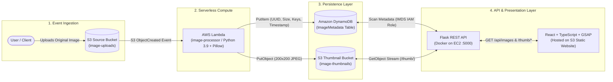

<div align="center">


# Serverless Image Processing Pipeline

**An Event-Driven Cloud Media Processing Pipeline & Real-Time Admin Console**  
*Built Locally with LocalStack & Docker — Deployed to Production on AWS with GitHub Actions CI/CD*

[](https://aws.amazon.com/)
[](https://localstack.cloud/)
[](https://www.python.org/)
[](https://react.dev/)
[](https://tailwindcss.com/)
[](https://github.com/features/actions)

</div>

---

## Overview

**Serverless Image Processing Pipeline** is a full-stack, cloud-native application that automatically generates optimized thumbnails and indexes image metadata the moment a file is uploaded to Amazon S3.

Designed with a **local-first cloud engineering workflow**, the entire AWS architecture (`S3` → `Lambda` → `DynamoDB` + `Flask API` + `React Admin Console`) was first engineered and debugged locally using **LocalStack** and **Docker Compose**, then migrated to **real AWS infrastructure** (`us-west-2`) with zero-secret **IAM Instance Profiles**, **OIDC federation**, and automated **GitHub Actions CI/CD pipelines**.

<div align="center">
  
  <p><em>Live Production React Admin Dashboard connected to AWS EC2, S3, and DynamoDB</em></p>
</div>

---

## System Architecture



### End-to-End Execution Flow
1. **Upload**: A user or service uploads an image to the S3 source bucket (`image-uploads` locally / `shanjid-2026-image-uploads` in AWS).
2. **Event Trigger**: S3 emits an `s3:ObjectCreated:*` notification event that asynchronously invokes the `image-processor` AWS Lambda function.
3. **Thumbnail Generation**: Lambda downloads the image stream into memory, resizes it to fit within a `200×200` bounding box while preserving aspect ratio via **Pillow (`cpython-39` C extensions)**, and writes the compressed JPEG to the thumbnail bucket (`thumb-<key>`).
4. **Metadata Indexing**: Lambda records a structured item (`image_id`, `original_key`, `thumbnail_key`, `size_bytes`, `uploaded_at`) in the **DynamoDB** `ImageMetadata` table (`PAY_PER_REQUEST` billing).
5. **API & Media Proxy**: A containerized **Flask** service running on **EC2** (authenticated keyless via an **IAM Instance Profile / IMDS**) exposes `/api/images` and proxies thumbnail binaries via `/thumb/<key>`, avoiding public exposure of the raw S3 thumbnail bucket.
6. **Admin Dashboard**: A responsive **React + TypeScript + Tailwind CSS + GSAP** frontend hosted on S3 visualizes processed assets, storage telemetry, and supports real-time search and filtering.

---

## Tech Stack

| Layer | Technologies Used |
| :--- | :--- |
| **Cloud Infrastructure (AWS)** | Amazon S3, AWS Lambda (`python3.9`), Amazon DynamoDB, Amazon EC2, AWS IAM (Roles, Instance Profiles, OIDC), CloudWatch Logs |
| **Local Cloud Emulation** | LocalStack `3.0`, Docker Engine, Docker Compose, `awscli-local` (`awslocal`) |
| **Serverless Compute** | Python `3.9`, `boto3`, `Pillow==10.4.0` (compiled inside `public.ecr.aws/sam/build-python3.9`) |
| **Backend API (`dashboard/`)** | Python `3.11`, Flask `3.0`, `flask-cors`, `boto3`, Docker |
| **Frontend (`frontend/`)** | React `19`, TypeScript, Vite `8`, Tailwind CSS `v4`, GSAP (`@gsap/react`), `lucide-react`, `date-fns` |
| **CI/CD & DevOps** | GitHub Actions, AWS OIDC (`configure-aws-credentials`), Docker Hub, SSH Remote Container Deployment |

---

## Repository Structure

```text
serverless-image-pipeline/
├── .github/workflows/                 # Path-filtered CI/CD pipelines
│   ├── deploy-lambda.yml              # Builds manylinux Pillow zip & updates AWS Lambda
│   ├── deploy-backend.yml             # Builds Docker image -> Docker Hub -> EC2 restart
│   └── deploy-frontend.yml            # Builds Vite React bundle -> syncs to S3 bucket
├── docs/
│   └── case-studies/                  # In-depth engineering root-cause analyses (Phases 0–4)
│       ├── 00-phase-0-localstack-permission-crash.md
│       ├── 01-phase-1-region-drift.md
│       ├── 02-phase-2-lambda-deployment-package.md
│       ├── 03-phase-2-docker-permission-failures.md
│       ├── 04-phase-2-pipeline-working.md
│       ├── 05-phase-3-dashboard.md
│       ├── 05-phase-4-real-aws-errors.md
│       └── 06-phase-4-iam-and-ec2.md
├── evidence/                          # Terminal logs & screenshot proofs across all phases
├── lambda/                            # Serverless image processor function
│   ├── app.py                         # S3 event handler (Pillow resize + DynamoDB put_item)
│   └── requirements.txt               # Pillow==10.4.0
├── dashboard/                         # Containerized Flask REST API & S3 thumbnail proxy
│   ├── app.py                         # /api/images & /thumb/<key> endpoints
│   ├── Dockerfile                     # python:3.11-slim container definition
│   └── requirements.txt               # flask, flask-cors, boto3
├── frontend/                          # React + TypeScript + Tailwind + GSAP Admin Console
│   ├── public/logo.png                # Custom application icon
│   ├── src/
│   │   ├── App.tsx                    # State management, theme persistence, API polling
│   │   ├── types.ts                   # ImageData TypeScript contract
│   │   └── components/                # Header, SearchBar, ImageGrid, ImageCard, LoadingSkeleton
│   └── package.json
├── docker-compose.yml                 # LocalStack + Dashboard local orchestration
├── trust-policy.json                  # Lambda IAM Role trust relationship
├── lambda-permissions.json            # Least-privilege S3 + DynamoDB + Logs policy for Lambda
├── ec2-permissions.json               # IAM Instance Profile policy for EC2 backend
└── frontend-policy.json               # Public-read bucket policy for S3 static website hosting
```

---

## Engineering Case Studies & Post-Mortems

A core focus of this project is **documented troubleshooting**. Every real-world blocker encountered across Linux containers, SELinux confinement, CPython ABI compatibility, and AWS IAM boundaries was investigated and written up as an engineering case study:

| Phase | Case Study | Key Engineering Takeaway |
| :---: | :--- | :--- |
| **Phase 0** | [**LocalStack Container Permission Crash**](docs/case-studies/00-phase-0-localstack-permission-crash.md) | Why `docker-compose up` reporting `Started` doesn't mean healthy, and how host bind-mount permissions & SELinux (`:z`) affect LocalStack 3.0's `/var/lib/localstack` directory. |
| **Phase 1** | [**Silent AWS Region Drift**](docs/case-studies/01-phase-1-region-drift.md) | How AWS CLI region resolution hierarchy (`~/.aws/config` vs. environment variables) caused silent resource drift between `us-east-1` and `us-west-2`, and how we standardized on `us-west-2`. |
| **Phase 2A** | [**The Lambda Deployment Package (`function.zip`)**](docs/case-studies/02-phase-2-lambda-deployment-package.md) | Why a 2.5 KB Python handler requires a 4.7 MB zip artifact, and why native C extensions (`PIL/_imaging.cpython-39-x86_64-linux-gnu.so`) must be built inside a matching `build-python3.9` container rather than a Python 3.14 host. |
| **Phase 2B** | [**Two Docker & SELinux Permission Failures**](docs/case-studies/03-phase-2-docker-permission-failures.md) | Diagnosing `Permission denied` on `/var/run/docker.sock` (`stat()` blocked by Fedora SELinux `docker_var_run_t`) when LocalStack spawns sibling Lambda containers, fixed via `security_opt: [label=disable]`. |
| **Phase 2C** | [**End-to-End Local Pipeline Verification**](docs/case-studies/04-phase-2-pipeline-working.md) | Resolving X-Ray UDP port `2000` collisions via custom Docker bridge networking (`localstack-net`) and verifying `<100ms` billed Lambda execution across S3 and DynamoDB. |
| **Phase 3** | [**Flask S3 Proxy Architecture**](docs/case-studies/05-phase-3-dashboard.md) | Why proxying thumbnails through `/thumb/<key>` beats S3 presigned URLs when browser clients sit outside internal Docker networks (`localstack:4566`) or private S3 buckets. |
| **Phase 4A** | [**Migrating from LocalStack to Real AWS**](docs/case-studies/05-phase-4-real-aws-errors.md) | Overcoming real AWS "Deny by Default" guardrails: IAM user bootstrapping, reserved `AWS_*` Lambda environment variables, and S3's `AccessControlListNotSupported` block on `public-read` ACLs. |
| **Phase 4B** | [**IAM Instance Profiles & EC2 Deployment**](docs/case-studies/06-phase-4-iam-and-ec2.md) | Eliminating hardcoded AWS credentials in Docker containers on EC2 by leveraging IAM Instance Profiles and the EC2 Instance Metadata Service (`169.254.169.254`). |

---

## Getting Started (Local Development with LocalStack)

### Prerequisites
- **Docker** & **Docker Compose V2**
- **AWS CLI v2** & `awscli-local` (`pip install awscli-local`)
- **Node.js 20+** & **npm**

### 1. Start LocalStack & Backend Services
```bash
export AWS_DEFAULT_REGION=us-west-2
docker compose up -d localstack
```
Verify LocalStack health:
```bash
curl -s http://localhost:4566/_localstack/health | jq .services
```

### 2. Provision Local S3 Buckets & DynamoDB Table
```bash
awslocal s3 mb s3://image-uploads --region us-west-2
awslocal s3 mb s3://image-thumbnails --region us-west-2

awslocal dynamodb create-table \
  --table-name ImageMetadata \
  --attribute-definitions AttributeName=image_id,AttributeType=S \
  --key-schema AttributeName=image_id,KeyType=HASH \
  --billing-mode PAY_PER_REQUEST \
  --region us-west-2
```

### 3. Build & Deploy the Lambda Function
Build the `cpython-39` compatible `function.zip` inside the official AWS SAM Python 3.9 build container:
```bash
cd lambda
rm -rf package function.zip

docker run --rm \
  --user "$(id -u):$(id -g)" \
  -e HOME=/tmp \
  -v "$PWD":/var/task:z \
  public.ecr.aws/sam/build-python3.9:latest \
  pip install --no-cache-dir -r /var/task/requirements.txt -t /var/task/package

cp app.py package/
(cd package && zip -r ../function.zip . > /dev/null)
cd ..
```

Deploy the function to LocalStack and wire the S3 event trigger:
```bash
awslocal lambda create-function \
  --function-name image-processor \
  --runtime python3.9 \
  --handler app.lambda_handler \
  --memory-size 256 \
  --timeout 30 \
  --role arn:aws:iam::000000000000:role/lambda-role \
  --zip-file fileb://lambda/function.zip \
  --environment "Variables={AWS_ENDPOINT_URL=http://localstack:4566,UPLOAD_BUCKET=image-uploads,THUMBNAIL_BUCKET=image-thumbnails,TABLE_NAME=ImageMetadata}" \
  --region us-west-2

awslocal s3api put-bucket-notification-configuration \
  --bucket image-uploads \
  --notification-configuration '{
    "LambdaFunctionConfigurations": [{
      "LambdaFunctionArn": "arn:aws:lambda:us-west-2:000000000000:function:image-processor",
      "Events": ["s3:ObjectCreated:*"]
    }]
  }'
```

### 4. Test the Pipeline End-to-End
```bash
# Upload a sample image
awslocal s3 cp test.jpg s3://image-uploads/

# Verify generated thumbnail & DynamoDB metadata
awslocal s3 ls s3://image-thumbnails/
awslocal dynamodb scan --table-name ImageMetadata --region us-west-2
```

### 5. Launch the Flask API & React Admin Console
Start the backend API container:
```bash
docker compose up -d --build dashboard
```
Start the React frontend in development mode:
```bash
cd frontend
npm install
npm run dev
```
Open `http://localhost:5173` in your browser.

---

## API Reference (`dashboard/app.py`)

| Method | Endpoint | Description | Sample Response |
| :---: | :--- | :--- | :--- |
| `GET` | `/api/images` | Scans the DynamoDB `ImageMetadata` table and returns all processed image records sorted newest-first. | `[{"image_id": "626e940c-...", "original_key": "test.jpg", "thumbnail_key": "thumb-test.jpg", "size_bytes": 6208, "uploaded_at": "2026-11-06T...Z"}]` |
| `GET` | `/thumb/<path:key>` | Streams the processed JPEG thumbnail directly from the S3 thumbnails bucket with `image/jpeg` MIME type. | Binary `image/jpeg` stream (`200 OK` or `404 Not Found`) |

---

## CI/CD Automation (GitHub Actions)

All three application tiers deploy automatically when changes are pushed to `main`:

1. **[`deploy-lambda.yml`](.github/workflows/deploy-lambda.yml)** *(triggers on `lambda/**`)*:
   - Authenticates to AWS via **GitHub OIDC** (`arn:aws:iam::...:role/GitHubActions-DeployRole`).
   - Compiles `Pillow` wheels inside `public.ecr.aws/sam/build-python3.9:latest`, packages `function.zip`, and executes `aws lambda update-function-code`.
2. **[`deploy-backend.yml`](.github/workflows/deploy-backend.yml)** *(triggers on `dashboard/**`)*:
   - Builds and pushes the Flask Docker image to Docker Hub (`image-dashboard:latest`).
   - Connects to the EC2 instance via SSH and restarts `dashboard-container` on port `5000`.
3. **[`deploy-frontend.yml`](.github/workflows/deploy-frontend.yml)** *(triggers on `frontend/**`)*:
   - Authenticates to AWS via OIDC, runs `npm ci && npm run build`, and syncs `frontend/dist/` to `s3://shanjid-2026-frontend/` with `--delete`.

---

## Visual Evidence Gallery

| Local Lambda Package Build (`cpython-39`) | End-to-End LocalStack Pipeline Proof |
| :---: | :---: |
|  |  |
| **AWS Console — Real S3 & Lambda Execution** | **Live React Admin Console on AWS** |
|  |  |

