<div align="center">

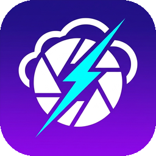

# Serverless Image Processing Pipeline

### Event-Driven Cloud Media Processing Engine & Real-Time Admin Console

**Engineered Locally with LocalStack & Docker • Deployed to Production AWS (`us-west-2`) with OIDC GitHub Actions CI/CD**

[](https://aws.amazon.com/)
[](https://localstack.cloud/)
[](https://www.python.org/)
[](https://react.dev/)
[](https://tailwindcss.com/)
[](https://gsap.com/)
[](https://github.com/features/actions)

<p align="center">
  <a href="#-executive-overview">Overview</a> •
  <a href="#-system-architecture">Architecture</a> •
  <a href="#-production-hardening-nginx--gunicorn-architecture-shift-phase-6">Production Hardening</a> •
  <a href="#-engineering-case-studies-root-cause-analyses">Case Studies (10)</a> •
  <a href="#-visual-evidence--verification-log-archive">Evidence & Logs</a> •
  <a href="#-cicd-automation-pipelines">CI/CD</a> •
  <a href="./docs/architecture.md">Architecture Doc</a> •
  <a href="./docs/runbook.md">Runbook</a>
</p>

</div>

---

## 🎯 Executive Overview

**Serverless Image Processing Pipeline** is an end-to-end, event-driven cloud application that automatically resizes uploaded images into optimized thumbnails and indexes structured metadata in real time.

Rather than treating cloud deployment as a black box, this project was built across **five rigorous engineering phases**:

1. **Local Cloud Emulation (`Phases 0–3`)**: Designed and stress-tested locally using **LocalStack 3.0**, **Docker Compose**, and **AWS SAM Python 3.9 build containers**—resolving real Linux kernel/SELinux confinement boundaries, CPython ABI incompatibilities (`cpython-39` vs. `cpython-314`), and Docker bridge networking.
2. **Production AWS Migration (`Phase 4`)**: Deployed to real **Amazon Web Services (`us-west-2`)** with **least-privilege IAM Roles**, **keyless EC2 Instance Profiles (IMDS)**, **S3 Static Website Hosting**, and **CORS-enabled REST proxying**.
3. **Zero-Touch CI/CD (`Phase 5`)**: Automated into three path-filtered **GitHub Actions workflows** using **AWS OIDC federated authentication** (no long-lived AWS credentials stored in GitHub).

<div align="center">
  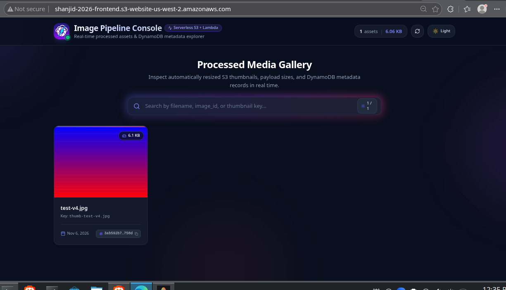
  <p><em><strong>Figure 1:</strong> Production React 19 + TypeScript + Tailwind CSS + GSAP Admin Console hosted on Amazon S3 (<code>shanjid-2026-frontend.s3-website-us-west-2.amazonaws.com</code>), querying live DynamoDB metadata and streaming S3 thumbnails via EC2.</em></p>
</div>

---

## ⚡ Key Engineering Highlights & Metrics

| Metric / Capability                     | Measured Result & Implementation Detail                                                                                                                                                                             |
| :-------------------------------------- | :------------------------------------------------------------------------------------------------------------------------------------------------------------------------------------------------------------------ |
| **Lambda Processing Latency**           | **~78–80 ms billed duration** (`256 MB` RAM allocation) for S3 download + Pillow JPEG resize + S3 upload + DynamoDB write.                                                                                          |
| **Payload Compression Ratio**           | **69.6% size reduction** (`6,208 bytes` original JPEG $\rightarrow$ `1,888 bytes` `200×150` JFIF thumbnail).                                                                                                        |
| **Cross-Platform Binary Compatibility** | Compiled `Pillow==10.4.0` C extensions (`_imaging.cpython-39-x86_64-linux-gnu.so`) inside `public.ecr.aws/sam/build-python3.9` to guarantee Amazon Linux 2 ABI compatibility from a Fedora Python 3.14 host.        |
| **Zero-Secret Compute Security**        | **0 hardcoded AWS keys** in production containers: EC2 authenticates via **IMDS + IAM Instance Profile** (`ec2-dashboard-profile`), and GitHub Actions authenticates via **AWS OIDC** (`GitHubActions-DeployRole`). |
| **Private S3 Media Proxy**              | Thumbnail bucket (`shanjid-2026-image-thumbnails`) remains **100% private** (`BucketOwnerEnforced`); images are streamed securely through Flask (`GET /thumb/<key>`).                                               |
| **Documented Root-Cause Analyses**      | **9 comprehensive engineering post-mortems** backed by **37 screenshots** and **8 raw terminal log captures**.                                                                                                      |

---

## 🏗️ System Architecture

> 📄 **Deep-Dive Documentation:** See [**`docs/architecture.md`**](docs/architecture.md) for the complete service inventory, DynamoDB data schema, and IAM least-privilege matrix.

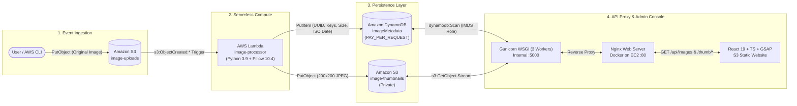

### Component Breakdown

| Directory / File                               | Role in the Architecture                                                                                                                                                                                                                                                                                                                 |
| :--------------------------------------------- | :--------------------------------------------------------------------------------------------------------------------------------------------------------------------------------------------------------------------------------------------------------------------------------------------------------------------------------------- |
| [**`lambda/app.py`**](lambda/app.py)           | Environment-aware AWS Lambda handler (`lambda_handler`). Parses S3 event payloads (with `unquote_plus` URL-decoding), streams the source image, converts transparent `RGBA` formats to `RGB`, generates an aspect-ratio-preserving `200×200` JPEG thumbnail via Pillow, writes `thumb-<key>` to S3, and persists metadata into DynamoDB. |
| [**`dashboard/`**](dashboard/)                 | Multi-process container combining **Nginx** (reverse proxy listening on public Port 80) and **Gunicorn** (3 WSGI workers on internal Port 5000) running [`app.py`](dashboard/app.py). Exposes `GET /api/images`, `POST /api/upload-url` (presigned S3 upload URLs), and `GET /thumb/<key>` with CORS support.                            |
| [**`frontend/src/`**](frontend/src/App.tsx)    | Strictly typed React 19 + TypeScript Admin Console styled with Tailwind CSS v4 (glassmorphism + persistent Dark/Light theme), animated with GSAP, featuring a drag-and-drop S3 direct upload zone.                                                                                                                                       |
| [**`docker-compose.yml`**](docker-compose.yml) | Orchestrates `localstack/localstack:3.0` (`s3,dynamodb,lambda,logs`) and `dashboard` on a custom bridge network (`localstack-net`) with SELinux socket compatibility (`security_opt: [label=disable]`).                                                                                                                                  |

---

## 🛡️ Production Hardening: Nginx + Gunicorn Multi-Process Architecture (Phase 6)

> [!IMPORTANT]
>
> ### Why We Eliminated Flask's Development Server in Production
>
> In early phases, the backend ran using Flask’s built-in development server (`app.run()`). While convenient for local development, it carried severe production liabilities:
>
> 1. **Single-Threaded Blocking**: A slow image download or DynamoDB query blocked all other concurrent requests.
> 2. **Unbuffered HTTP & Security Vulnerabilities**: Direct internet exposure to development WSGI servers leaves applications susceptible to slowloris attacks and connection exhaustion.
> 3. **Non-Standard Custom Port (`:5000`)**: Forces clients and browsers to explicitly request an unnatural port rather than the standard web port.

To achieve enterprise-grade reliability, we restructured the container into a **two-tier multi-process architecture**:

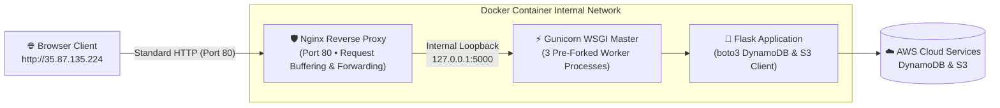

### ⚖️ The "Port 80 vs. Port 5000" Security Boundary

| Dimension                   | Development Setup (`:5000`)                                       | Hardened Production Setup (`:80` + Nginx)                                           |
| :-------------------------- | :---------------------------------------------------------------- | :---------------------------------------------------------------------------------- |
| **User Experience**         | Requires awkward port suffix in URLs: `http://35.87.135.224:5000` | Standard web default: clean URL `http://35.87.135.224`                              |
| **Concurrency**             | Single process; consecutive requests queue synchronously          | **3 Pre-forked Gunicorn Workers** handle concurrent requests in parallel            |
| **Attack Surface**          | Python WSGI directly bound to public interface                    | Python app isolated on container loopback (`127.0.0.1:5000`); only Nginx is exposed |
| **Reverse Proxy Buffering** | None (client network lag ties up Python worker threads)           | Nginx buffers slow client uploads/downloads before handing off to Python            |

### 🔄 Cascading Stack Updates Across the CI/CD Pipeline

Transitioning from Port 5000 to Port 80 required synchronized orchestration across 4 repository components:

- 🐳 [**`dashboard/Dockerfile`**](dashboard/Dockerfile): Multi-process container installing `nginx`, mounting custom config, and starting both daemons:
  ```dockerfile
  CMD service nginx start && gunicorn --bind 0.0.0.0:5000 --workers 3 app:app
  ```
- ⚙️ [**`dashboard/nginx.conf`**](dashboard/nginx.conf): Listens on 80, reverse-proxies to `http://127.0.0.1:5000`, and passes client identity headers (`X-Real-IP`, `X-Forwarded-For`).
- 🚀 [**`.github/workflows/deploy-backend.yml`**](.github/workflows/deploy-backend.yml): Updated the automated EC2 rollout to bind `-p 80:80`.
- 🔒 **AWS Security Group** (`sg-00baed54e5d8fe23d`): Authorized inbound HTTP on port 80.
- 💻 [**`frontend/.env`**](frontend/.env): Cleaned API endpoint URL to drop the `:5000` port requirement (`http://35.87.135.224`).

---

## 🔬 Engineering Case Studies (Root-Cause Analyses)

Every real-world failure encountered while building and migrating this system was diagnosed from first principles and documented as a standalone engineering post-mortem in [**`docs/case-studies/`**](docs/case-studies/):

|   #    | Case Study Document                                                                                             |   Phase    | Problem Solved & Core Technical Insight                                                                                                                                                                                                       |
| :----: | :-------------------------------------------------------------------------------------------------------------- | :--------: | :-------------------------------------------------------------------------------------------------------------------------------------------------------------------------------------------------------------------------------------------- |
| **00** | [**LocalStack Container Crash on Startup**](docs/case-studies/00-phase-0-localstack-permission-crash.md)        | `Phase 0`  | Why `docker-compose up` reporting `Started` masked an immediate `Exited (1)` crash (`mkdir: cannot create directory '/var/lib/localstack/logs': Permission denied`), and how host bind-mount ownership + SELinux `:z` relabeling resolved it. |
| **01** | [**Silent AWS Region Drift & Config Mismatch**](docs/case-studies/01-phase-1-region-drift.md)                   | `Phase 1`  | How the AWS CLI region resolution chain (`~/.aws/config` vs. `AWS_DEFAULT_REGION`) silently created DynamoDB in `us-west-2` while containers targeted `us-east-1`, and how we standardized the entire stack on `us-west-2`.                   |
| **02** | [**The Lambda Deployment Package (`function.zip`)**](docs/case-studies/02-phase-2-lambda-deployment-package.md) | `Phase 2A` | Why a `2.5 KB` Python handler requires a `4.7 MB` zip artifact, and why native C extensions (`_imaging.cpython-39-x86_64-linux-gnu.so`) must be built inside `public.ecr.aws/sam/build-python3.9` rather than a Python 3.14 host.             |
| **03** | [**Two Docker & SELinux Permission Failures**](docs/case-studies/03-phase-2-docker-permission-failures.md)      | `Phase 2B` | Diagnosing `State: Failed` (`"Docker not available"`) when LocalStack attempted to spawn sibling Lambda containers—caused by Fedora SELinux blocking `stat()` on `/var/run/docker.sock`, solved with `security_opt: [label=disable]`.         |
| **04** | [**End-to-End Local Pipeline Verification**](docs/case-studies/04-phase-2-pipeline-working.md)                  | `Phase 2C` | Overcoming X-Ray UDP port `2000` collisions via custom Docker bridge networking (`localstack-net`), catching corrupt test inputs (`UnidentifiedImageError`), and verifying `<100ms` end-to-end execution.                                     |
| **05** | [**Containerized Flask S3 Proxy Architecture**](docs/case-studies/05-phase-3-dashboard.md)                      | `Phase 3`  | Why proxying thumbnails through Flask (`/thumb/<key>`) is superior to S3 presigned URLs when browser clients cannot resolve internal Docker DNS (`localstack:4566`) or when S3 buckets block public access.                                   |
| **06** | [**Migrating from LocalStack to Real AWS**](docs/case-studies/05-phase-4-real-aws-errors.md)                    | `Phase 4A` | Navigating 5 real-AWS "Deny by Default" guardrails: IAM user self-bootstrapping via CloudShell, reserved `AWS_*` Lambda environment variables, and S3's `AccessControlListNotSupported` rejection of `ACL="public-read"`.                     |
| **07** | [**IAM Instance Profiles, EC2, & Live React Console**](docs/case-studies/06-phase-4-iam-and-ec2.md)             | `Phase 4B` | How Docker containers on EC2 authenticate to DynamoDB and S3 without `AWS_ACCESS_KEY_ID` via the EC2 Instance Metadata Service (`169.254.169.254`) and IAM Instance Profiles (`ec2-dashboard-profile`).                                       |
| **08** | [**Lambda Image Processing Bug Fixes**](docs/case-studies/06-phase-img-process-bug.md)                          | `Phase 4B` | Resolving `s3:GetObject` `NoSuchKey` failures from S3 URL-encoded object keys (`+` for spaces) using `urllib.parse.unquote_plus` and eliminating `OSError: cannot write mode RGBA as JPEG` on transparent PNGs via `.convert('RGB')`.         |
| **09** | [**CI/CD OIDC Authentication & GitHub Immutable ID Trap**](docs/case-studies/07-phase-6-cicd-oidc-errors.md)    | `Phase 6`  | Resolving `sts:AssumeRoleWithWebIdentity` failures caused by GitHub's immutable numeric repository IDs in OIDC `sub` claims, plus fixing a case-sensitive Docker Hub authorization error (`Levi9111` vs `levi9111`).                          |
| **10** | [**Production Hardening with Nginx & Gunicorn**](docs/case-studies/07-phase-6-production-hardening-nginx.md)    | `Phase 6`  | Eliminating Flask's single-threaded dev server by containerizing an Nginx reverse proxy (standard HTTP Port 80) and Gunicorn WSGI master (`3 workers`) on internal Port 5000, cascading updates across CI/CD and Security Groups.             |

---

## 📸 Visual Evidence & Verification Log Archive

Every phase of this project is backed by verifiable terminal logs (`.txt`) and screenshots (`.png`) stored in [**`evidence/`**](evidence/).

### Phase 2A — Building the `cpython-39` Lambda Package (`function.zip`)

|                     1. Initial Build Failure (`Permission denied`)                      |                         2. Workspace & Root Artifact Cleanup                         |
| :-------------------------------------------------------------------------------------: | :----------------------------------------------------------------------------------: |
|                   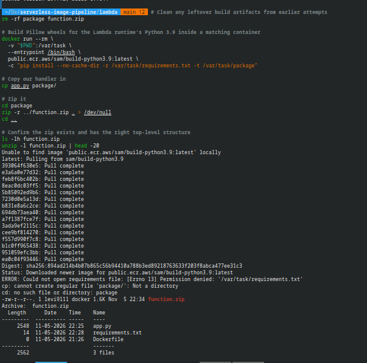                    |                  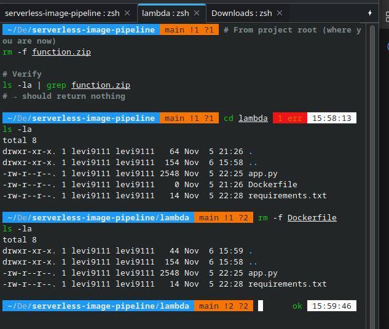                  |
| 📄 **Raw Log:** [`phase-2-build-FAILED-log.txt`](evidence/phase-2-build-FAILED-log.txt) | 🖼️ **Root Cleanup:** [`phase-2-root-cleanup.png`](evidence/phase-2-root-cleanup.png) |

|                      3. Containerized `Pillow==10.4.0` Wheel Install                      |                  4. Verified `4.7 MB` `function.zip` (`cpython-39` ABI)                   |
| :---------------------------------------------------------------------------------------: | :---------------------------------------------------------------------------------------: |
|                   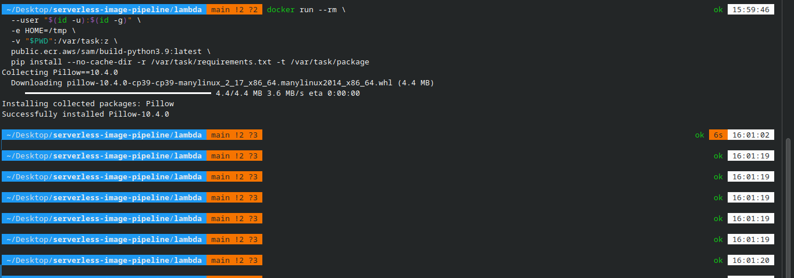                    |                  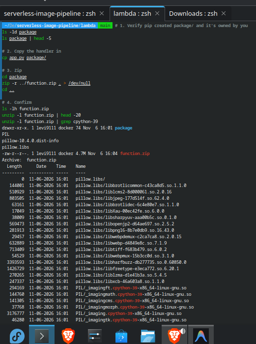                  |
| 📄 **Raw Log:** [`phase-2-build-success-log.txt`](evidence/phase-2-build-success-log.txt) | 📄 **Raw Log:** [`phase-2-build-package-log.txt`](evidence/phase-2-build-package-log.txt) |

---

### Phase 2B & 2C — Docker Socket SELinux Fix, S3 Trigger Wiring & Local E2E Run

|                             1. Lambda Created (`State: Pending`)                              |                      2. Fixing `/var/run/docker.sock` SELinux Denial                       |
| :-------------------------------------------------------------------------------------------: | :----------------------------------------------------------------------------------------: |
|               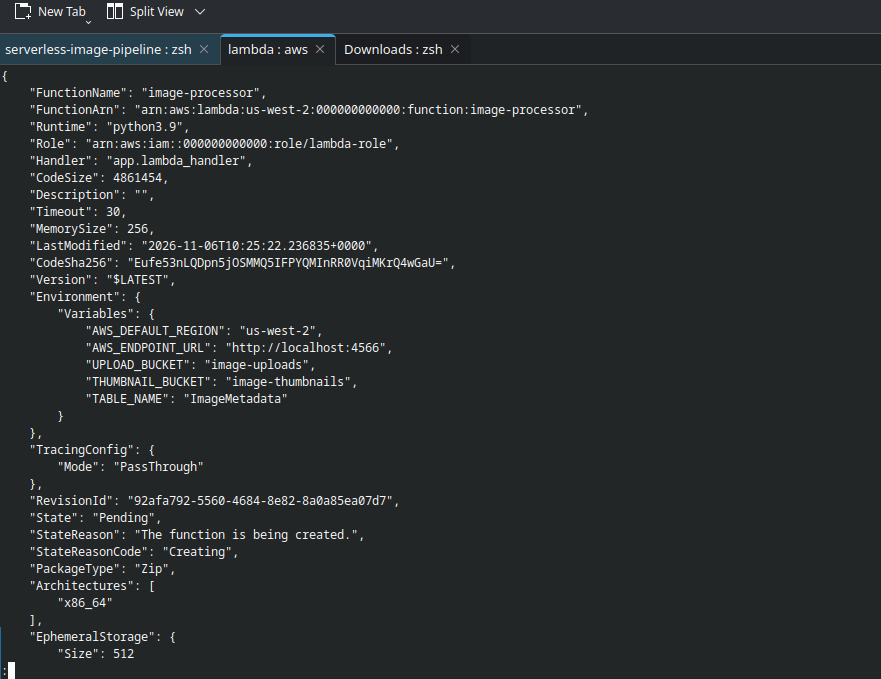                |                 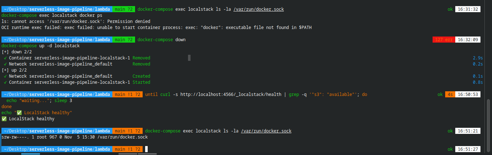                  |
| 📄 **Raw Log:** [`phase-2-function-config-log.txt`](evidence/phase-2-function-config-log.txt) | Resolved via `security_opt: [label=disable]` in [`docker-compose.yml`](docker-compose.yml) |

|                           3. Polling Lambda to `State: Active`                            |                                                                                                4. S3 Invoke Permission & Trigger Configuration                                                                                                |
| :---------------------------------------------------------------------------------------: | :-------------------------------------------------------------------------------------------------------------------------------------------------------------------------------------------------------------------------------------------: |
|                   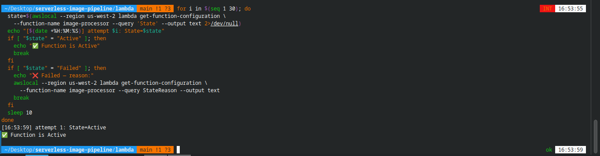                    |                                                                                            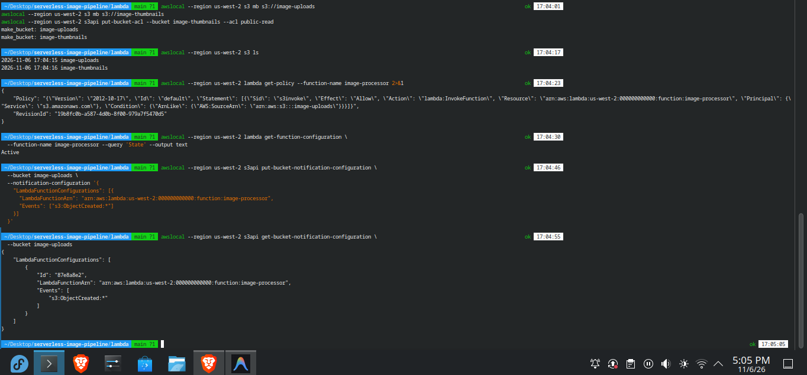                                                                                             |
| 📄 **Raw Log:** [`phase-2-lambda-ACTIVE-log.txt`](evidence/phase-2-lambda-ACTIVE-log.txt) | 📄 **Raw Log:** [`phase-2-state-restored-log.txt`](evidence/phase-2-state-restored-log.txt) • 🖼️ [`phase-2-add-permission.png`](evidence/phase-2-add-permission.png) • 🖼️ [`phase-2-state-restored.png`](evidence/phase-2-state-restored.png) |

|                                        5. End-to-End LocalStack Execution (`DynamoDB` + `S3` + `Logs`)                                         |                                       6. Binary & Visual Verification of `200×150` Thumbnail                                       |
| :--------------------------------------------------------------------------------------------------------------------------------------------: | :--------------------------------------------------------------------------------------------------------------------------------: |
|                                                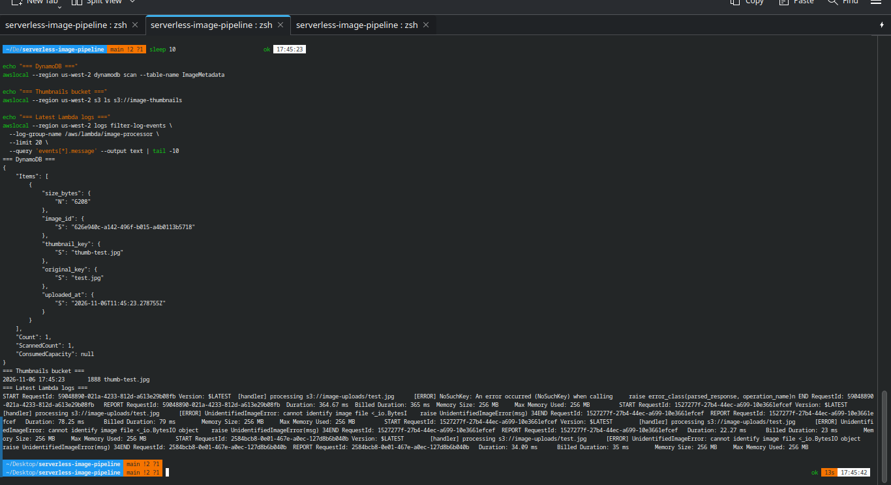                                                |                                   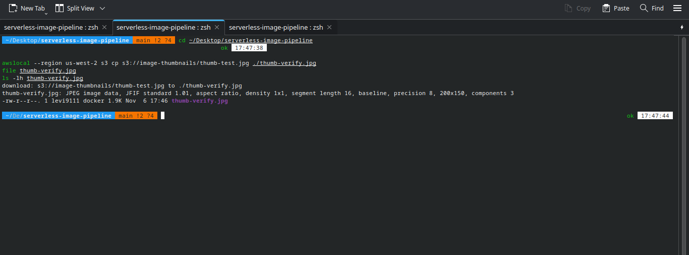                                   |
| 📄 **Raw Log:** [`phase-2-e2e-success-log.txt`](evidence/phase-2-e2e-success-log.txt) • 🖼️ [`phase-2-upload.png`](evidence/phase-2-upload.png) | 🖼️ **Visual Preview:** [`phase-2-thumbnail-visual.png`](evidence/phase-2-thumbnail-visual.png) (`6,208 B` $\rightarrow$ `1,888 B`) |

---

### Phase 3 — Containerized Flask API & Thumbnail Proxy Verification

|                                                         1. Building `python:3.11-slim` Dashboard Image (`51.3s`)                                                         |                   2. CLI Health Check & `/thumb/thumb-test.jpg` Proxy Test                   |
| :----------------------------------------------------------------------------------------------------------------------------------------------------------------------: | :------------------------------------------------------------------------------------------: |
|                                                         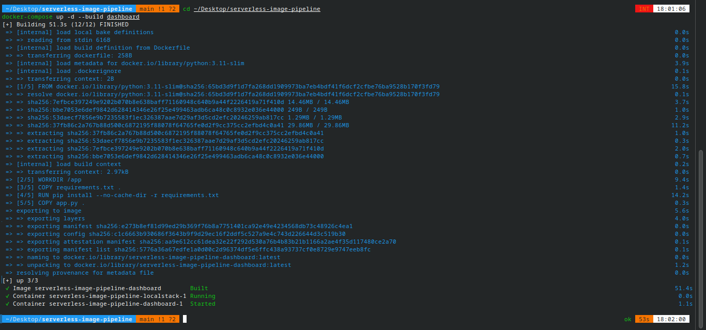                                                         |                         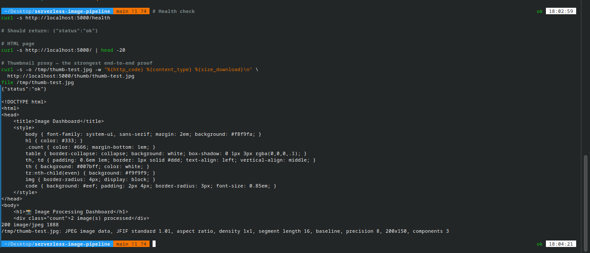                         |
| 📄 **Raw Log:** [`phase-3-dashboard-built-log.txt`](evidence/phase-3-dashboard-built-log.txt) • 🖼️ [`phase-3-dashboard-files.png`](evidence/phase-3-dashboard-files.png) | 🖼️ **Initial Browser View:** [`phase-3-browser-view.png`](evidence/phase-3-browser-view.png) |

---

### Phase 4 — Production AWS Deployment (`us-west-2`), IAM, EC2 & Live React Dashboard

|                                                                                 1. IAM Policy Bootstrap via AWS CloudShell                                                                                  |                                                                             2. Lambda `State: Active` & DynamoDB Scan on Real AWS                                                                              |
| :---------------------------------------------------------------------------------------------------------------------------------------------------------------------------------------------------------: | :------------------------------------------------------------------------------------------------------------------------------------------------------------------------------------------------------------: |
|                                                                  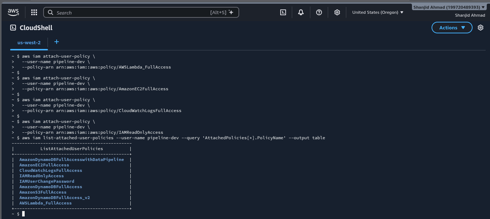                                                                   |                                                                        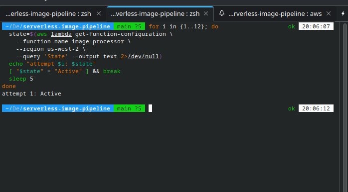                                                                         |
| 🖼️ **DynamoDB Table:** [`phase-4-real-resources-created.png`](evidence/phase-4-real-resources-created.png) • 🖼️ **Role ARN:** [`phase-4-lambda-role-created.png`](evidence/phase-4-lambda-role-created.png) | 🖼️ **CLI Scan Output:** [`phase-4-real-pipeline-working.png`](evidence/phase-4-real-pipeline-working.png) • 🖼️ **Security Group:** [`Screenshot_20261106_202539.png`](evidence/Screenshot_20261106_202539.png) |

|     3. AWS Console — Source S3 Bucket (`shanjid-2026-image-uploads`)     | 4. AWS Console — Thumbnail S3 Bucket (`shanjid-2026-image-thumbnails`) |
| :----------------------------------------------------------------------: | :--------------------------------------------------------------------: |
| 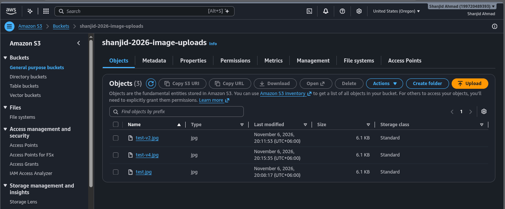 | 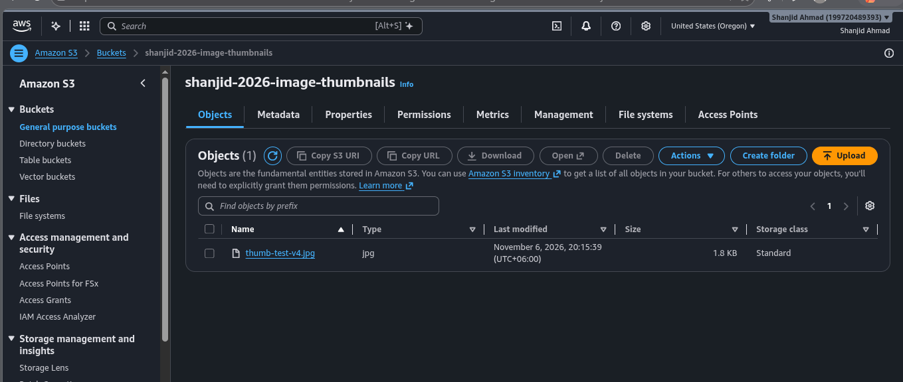  |

|          5. AWS Console — DynamoDB `ImageMetadata` Record           |                    6. Production EC2 API (`35.87.135.224:5000`) & S3 React Console                    |
| :-----------------------------------------------------------------: | :---------------------------------------------------------------------------------------------------: |
| 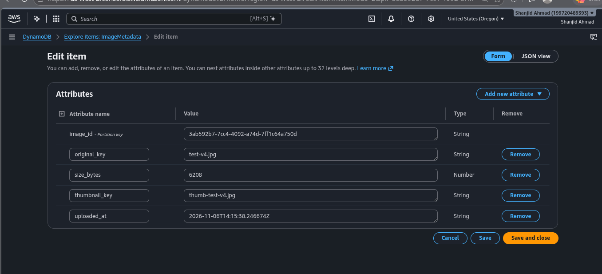 |                               |
|  Partition Key: `3ab592b7-7cc4-4092-a74d-7ff1c64a750d` (`6,208 B`)  | 🖼️ **Initial EC2 Check:** [`phase-4-ec2-dashboard-live.png`](evidence/phase-4-ec2-dashboard-live.png) |

---

### Phase 6 — CI/CD Pipelines (GitHub Actions OIDC, Docker Hub & EC2 SSH Rollout)

|                    1. Initial OIDC `AssumeRoleWithWebIdentity` Failure                    |   2. OIDC Fixed (`repo:Levi9111@*/...` Immutable ID Match)   |
| :---------------------------------------------------------------------------------------: | :----------------------------------------------------------: |
|                 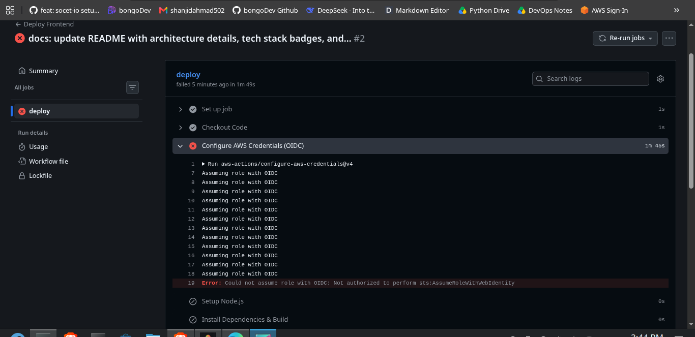                  | 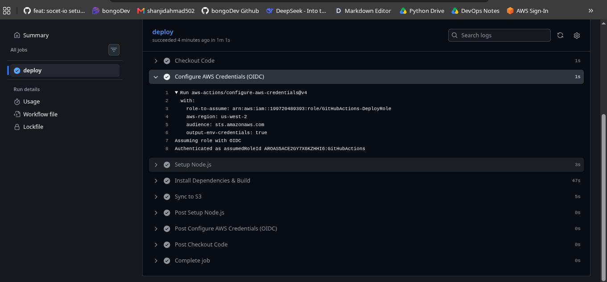 |
| 🖼️ **Workflow Tree:** [`phase-6-repo-workflows.png`](evidence/phase-6-repo-workflows.png) |      Authenticated as `assumedRoleId ...:GitHubActions`      |

|                3. Frontend CI/CD Pipeline Green (`1m 1s`)                | 4. Live S3 Frontend Updated via CI/CD (`1 / 1` Badge Fixed) |
| :----------------------------------------------------------------------: | :---------------------------------------------------------: |
| 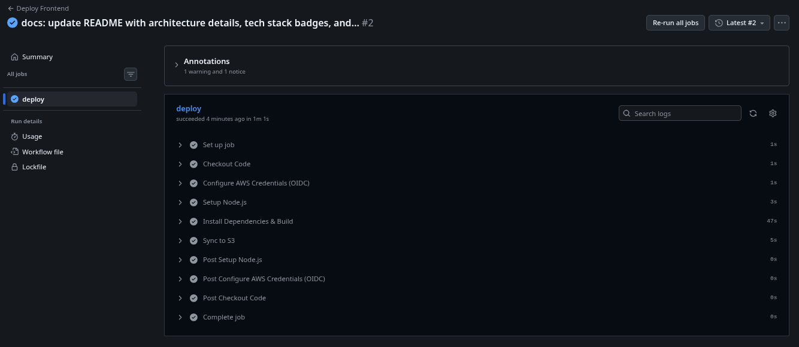 | 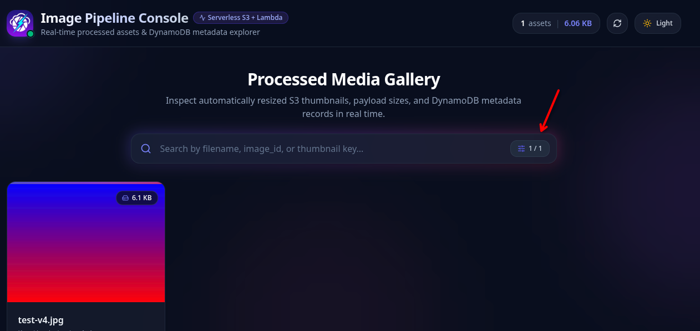 |

|       5. Backend CI/CD — EC2 SSH Container Rollout (`30s`)       |   6. Live EC2 Backend Root UI (`v1.1.0 (CI/CD Active)`)   |
| :--------------------------------------------------------------: | :-------------------------------------------------------: |
| 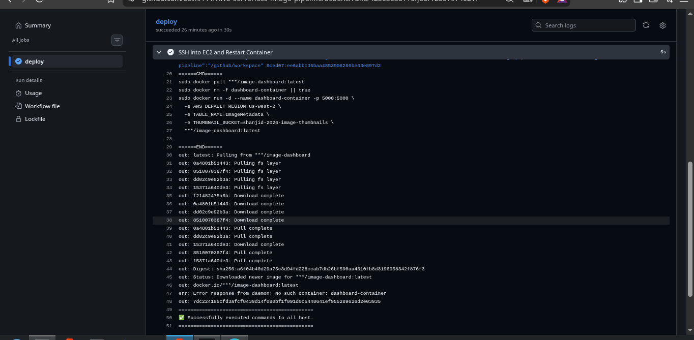 | 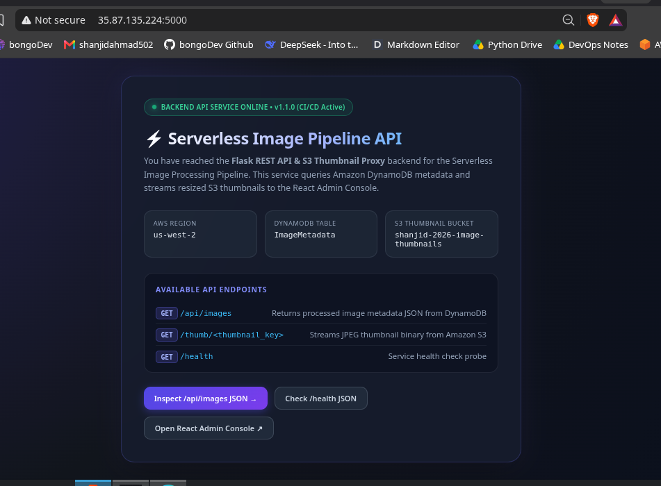 |

|   7. Serverless Lambda CI/CD Pipeline (`deploy-lambda.yml` — `43s`)    |
| :--------------------------------------------------------------------: |
| 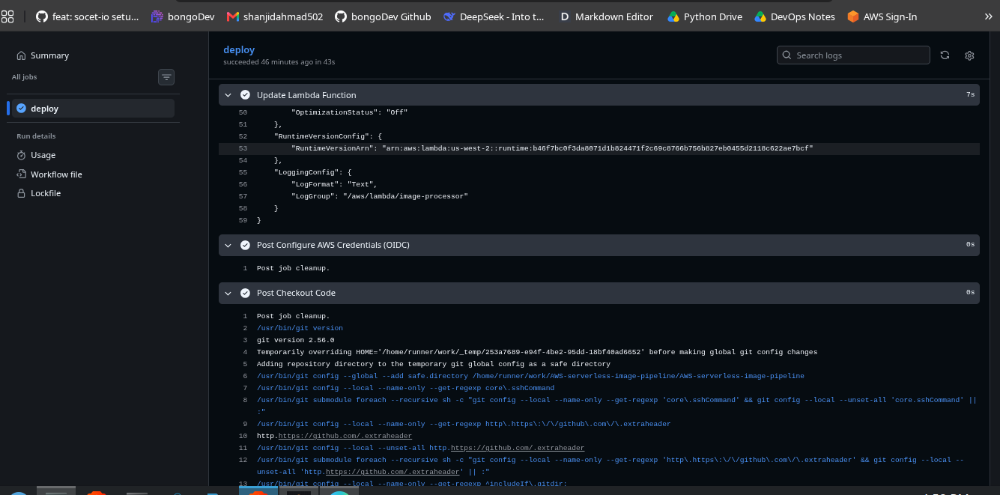 |

---

## 🔄 CI/CD Automation Pipelines (`.github/workflows/`)

All three tiers are continuously deployed on push to `main` using path-based triggers:

| Workflow File                                                      |  Path Trigger  | Authentication                            | Automated Pipeline Steps                                                                                                                                              |
| :----------------------------------------------------------------- | :------------: | :---------------------------------------- | :-------------------------------------------------------------------------------------------------------------------------------------------------------------------- |
| [**`deploy-lambda.yml`**](.github/workflows/deploy-lambda.yml)     |  `lambda/**`   | **AWS OIDC** (`GitHubActions-DeployRole`) | Spins up `public.ecr.aws/sam/build-python3.9:latest`, installs `Pillow==10.4.0`, packages `function.zip`, and runs `aws lambda update-function-code` in `us-west-2`.  |
| [**`deploy-backend.yml`**](.github/workflows/deploy-backend.yml)   | `dashboard/**` | **Docker Hub Token + EC2 SSH**            | Builds `image-dashboard:latest`, pushes to Docker Hub, SSHs into EC2 (`appleboy/ssh-action`), pulls the new image, and restarts `dashboard-container` on port `5000`. |
| [**`deploy-frontend.yml`**](.github/workflows/deploy-frontend.yml) | `frontend/**`  | **AWS OIDC** (`GitHubActions-DeployRole`) | Sets up Node.js 20, runs `npm ci && npm run build` (`tsc -b && vite build`), and syncs `frontend/dist/` to `s3://shanjid-2026-frontend/` with `--delete`.             |

---

## 📂 Complete Repository Structure

```text
serverless-image-pipeline/
├── README.md                                              # Main project documentation & visual portfolio
├── docker-compose.yml                                     # LocalStack 3.0 + Flask API container orchestration
├── docs/
│   ├── architecture.md                                    # Detailed system architecture, data model & IAM matrix
│   ├── runbook.md                                         # Step-by-step LocalStack & AWS operational runbook
│   └── case-studies/                                      # 10 engineering root-cause analysis documents
│       ├── 00-phase-0-localstack-permission-crash.md
│       ├── 01-phase-1-region-drift.md
│       ├── 02-phase-2-lambda-deployment-package.md
│       ├── 03-phase-2-docker-permission-failures.md
│       ├── 04-phase-2-pipeline-working.md
│       ├── 05-phase-3-dashboard.md
│       ├── 05-phase-4-real-aws-errors.md
│       ├── 06-phase-4-iam-and-ec2.md
│       ├── 06-phase-img-process-bug.md
│       └── 07-phase-6-cicd-oidc-errors.md
├── evidence/                                              # 37 screenshots (.png) + 8 raw terminal logs (.txt)
├── .github/workflows/                                     # Automated CI/CD pipelines
│   ├── deploy-lambda.yml
│   ├── deploy-backend.yml
│   └── deploy-frontend.yml
├── lambda/                                                # Serverless image processor (Python 3.9 + Pillow)
│   ├── app.py                                             # S3 event handler -> Pillow thumbnail -> DynamoDB
│   ├── requirements.txt                                   # Pillow==10.4.0
│   └── ec2-trust-policy.json                              # IAM trust policy for EC2 instance profile
├── dashboard/                                             # Flask REST API & S3 media stream proxy
│   ├── app.py                                             # GET /api/images & GET /thumb/<key>
│   ├── Dockerfile                                         # python:3.11-slim container build
│   └── requirements.txt                                   # flask==3.0.0, flask-cors==4.0.0, boto3==1.34.0
├── frontend/                                              # React 19 + TypeScript + Tailwind v4 + GSAP Console
│   ├── public/logo.png                                    # Custom high-contrast application icon
│   ├── src/
│   │   ├── App.tsx                                        # Main dashboard state, theme sync & error handling
│   │   ├── types.ts                                       # ImageData TypeScript interface
│   │   └── components/
│   │       ├── Header.tsx                                 # Glassmorphic top bar, live metrics & theme toggle
│   │       ├── SearchBar.tsx                              # Instant search input & match counter badge
│   │       ├── ImageGrid.tsx                              # GSAP stagger entrance & filter animations
│   │       ├── ImageCard.tsx                              # Thumbnail card, hover physics & 1-click ID copy
│   │       └── LoadingSkeleton.tsx                        # Responsive shimmer loading state
│   ├── package.json
│   └── vite.config.ts
├── trust-policy.json                                      # IAM trust policy for Lambda execution role
├── lambda-permissions.json                                # Scoped S3 & DynamoDB policy for Lambda
├── ec2-permissions.json                                   # Scoped S3 & DynamoDB policy for EC2 backend
└── frontend-policy.json                                   # Public-read S3 bucket policy for static website hosting
```

---

## 🚀 Quick Start

> 📘 For full local and production deployment commands, see the [**Operations & Deployment Runbook (`docs/runbook.md`)**](docs/runbook.md).

```bash
# 1. Start LocalStack & Flask API
export AWS_DEFAULT_REGION=us-west-2
docker compose up -d --build

# 2. Start the React + TypeScript Admin Console
cd frontend
npm install
npm run dev
```

---

## 🔌 REST API Contract (`dashboard/app.py`)

| Method | Route               | Description                                                                                                        | Response Format                                          |
| :----: | :------------------ | :----------------------------------------------------------------------------------------------------------------- | :------------------------------------------------------- |
| `GET`  | `/api/images`       | Scans the DynamoDB `ImageMetadata` table and returns all processed image items sorted descending by `uploaded_at`. | `200 OK` (`application/json` array of `ImageData`)       |
| `GET`  | `/thumb/<path:key>` | Streams the processed thumbnail binary directly from S3 (`shanjid-2026-image-thumbnails` / `image-thumbnails`).    | `200 OK` (`image/jpeg` binary stream) or `404 Not Found` |
