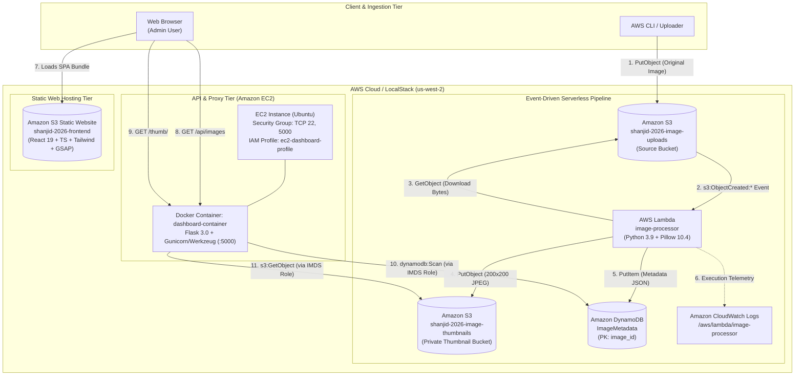
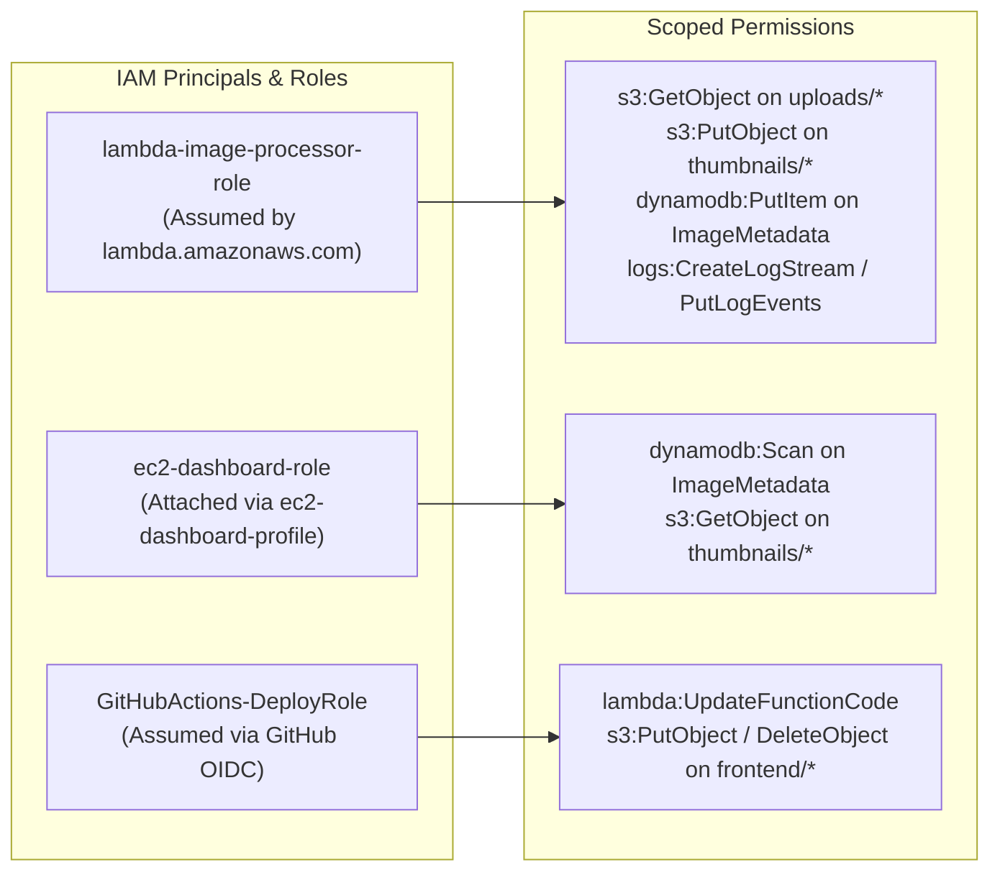
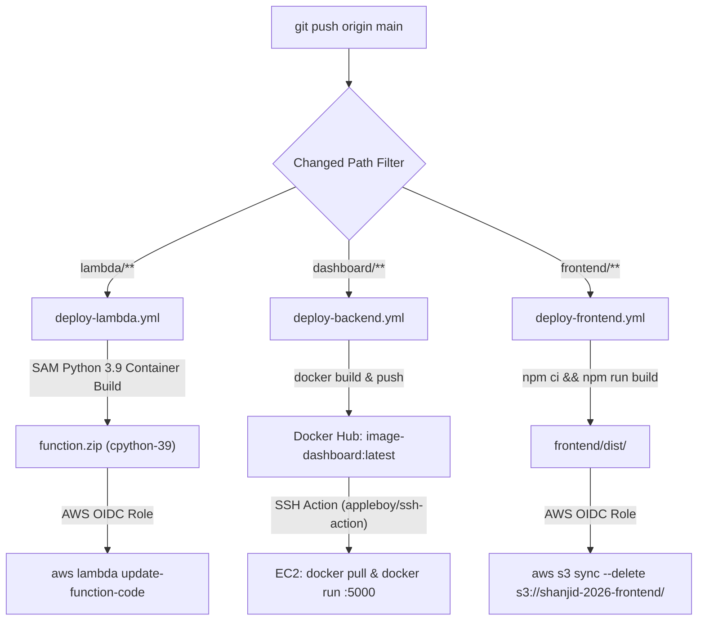

  <a href="../README.md">🏠 Back to Main README</a> &nbsp;|&nbsp;
  <a href="./runbook.md">📘 Operations Runbook</a> &nbsp;|&nbsp;
  <a href="./case-studies/00-phase-0-localstack-permission-crash.md">🔬 Case Studies</a>

---

# System Architecture & Service Map

This document details the cloud architecture, data flow, IAM security model, network topology, and CI/CD automation of the **Serverless Image Processing Pipeline**.

---

## 1. High-Level Cloud Architecture

---

## 2. Service Map & Resource Inventory

| Service Tier | Resource Name (LocalStack) | Resource Name (Production AWS `us-west-2`) | Purpose & Configuration |
| :--- | :--- | :--- | :--- |
| **Source Storage** | `s3://image-uploads` | `s3://shanjid-2026-image-uploads` | Receives raw image uploads; configured with `LambdaFunctionConfigurations` on `s3:ObjectCreated:*`. |
| **Serverless Compute** | `image-processor` | `arn:aws:lambda:us-west-2:199720489393:function:image-processor` | Python `3.9`, `256 MB` RAM, `30s` timeout, `x86_64` `cpython-39` Pillow package (`function.zip`). |
| **Processed Storage** | `s3://image-thumbnails` | `s3://shanjid-2026-image-thumbnails` | Stores resized JPEG thumbnails (`thumb-<original_key>`). Private bucket; accessed via Flask proxy. |
| **NoSQL Metadata Store** | `ImageMetadata` | `arn:aws:dynamodb:us-west-2:199720489393:table/ImageMetadata` | Partition Key: `image_id` (`String`), `PAY_PER_REQUEST` (On-Demand) capacity mode. |
| **Backend REST API** | `dashboard` (`localstack-net:5000`) | EC2 `i-011898b03051e8d61` (`35.87.135.224:5000`) | Flask `3.0` + `flask-cors` Docker container serving `/api/images` and `/thumb/<key>`. |
| **Frontend Console** | `localhost:5173` (Vite Dev) | `s3://shanjid-2026-frontend` | React 19 + TypeScript + Tailwind v4 + GSAP SPA served via S3 Static Website Hosting. |

---

## 3. Data Model (`ImageMetadata` DynamoDB Table)

Every processed image writes a single item to `ImageMetadata`:

| Attribute | DynamoDB Type | Example Value | Description |
| :--- | :---: | :--- | :--- |
| **`image_id`** *(PK)* | `S` (String) | `"626e940c-a142-496f-b015-a4b0113b5718"` | UUIDv4 generated at processing time. |
| **`original_key`** | `S` (String) | `"test-v4.jpg"` | Object key in the source S3 upload bucket. |
| **`thumbnail_key`** | `S` (String) | `"thumb-test-v4.jpg"` | Object key in the S3 thumbnail bucket. |
| **`size_bytes`** | `N` (Number) | `6208` | Original uploaded file size in bytes. |
| **`uploaded_at`** | `S` (String) | `"2026-11-06T14:15:38.246674Z"` | ISO-8601 UTC timestamp of processing. |

---

## 4. Security & IAM Least-Privilege Matrix

- **Lambda Execution Policy**: Defined in [`trust-policy.json`](../trust-policy.json) and [`lambda-permissions.json`](../lambda-permissions.json).
- **EC2 Instance Profile Policy**: Defined in [`lambda/ec2-trust-policy.json`](../lambda/ec2-trust-policy.json) and [`ec2-permissions.json`](../ec2-permissions.json).
- **Frontend Bucket Policy**: Defined in [`frontend-policy.json`](../frontend-policy.json) (`s3:GetObject` scoped strictly to static web assets in `shanjid-2026-frontend/*`).

---

## 5. CI/CD Deployment Topology (`.github/workflows/`)

---

  <a href="../README.md">🏠 Back to Main README</a> &nbsp;|&nbsp;
  <a href="./runbook.md">📘 Next: Operations Runbook ➡️</a>

