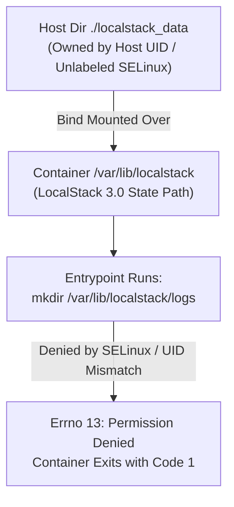

<div align="center">
  <a href="../../README.md">🏠 Back to Main README</a> &nbsp;|&nbsp;
  <a href="../architecture.md">🏗️ Architecture</a> &nbsp;|&nbsp;
  <a href="../runbook.md">📘 Runbook</a> &nbsp;|&nbsp;
  <a href="./01-phase-1-region-drift.md">Next: Phase 1 — Region Drift ➡️</a>
</div>

---

# Case Study 00: LocalStack Container Crash on Startup (Phase 0)

| Field | Details |
| :--- | :--- |
| **Project** | Serverless Image Processing Pipeline |
| **Phase** | Phase 0 — Local Cloud Emulation Setup |
| **Environment** | Linux (Fedora/SELinux), Docker Engine, Docker Compose V2, LocalStack `3.0.2` |
| **Severity** | 🔴 **Blocker** (Halted all local cloud emulation) |
| **Time to Resolve** | ~15 minutes |
| **Status** | ✅ **Resolved** — LocalStack `3.0.2` running with `s3`, `dynamodb`, and `lambda` all `available` |

---

## 1. Executive Summary

During the initial setup of the local cloud development environment, two permission-related failures occurred in sequence:
1. The first prevented the Docker CLI from communicating with the Docker daemon socket (`/var/run/docker.sock`).
2. The second — and far more instructive failure — allowed the LocalStack container to **report `Container Started` in Docker Compose** while silently crashing within seconds, leaving the `:4566` health endpoint unreachable.

The root cause was a **host–container permission and SELinux label mismatch on a bind-mounted volume (`./localstack_data:/var/lib/localstack`)**, compounded by **misleading status reporting** from `docker-compose up -d`.

---

## 2. Incident Timeline

| Step | Action | Observed Signal | Assessment |
| :---: | :--- | :--- | :--- |
| **1** | `docker-compose up -d localstack` | `permission denied ... unix:///var/run/docker.sock` | ❌ Host user missing from `docker` group |
| **2** | `sudo usermod -aG docker $USER && newgrp docker` | `docker ps` succeeds | ✅ Docker CLI functional |
| **3** | `docker-compose up -d localstack` | Compose reports **`✔ Container Started`** | ⚠️ Misleading positive signal |
| **4** | `curl localhost:4566/_localstack/health` | `Connection refused` | ❌ Service not listening |
| **5** | `docker-compose ps` | **Empty table** — container not listed | 🔍 Stopped containers hidden by default |
| **6** | `docker ps -a` | Container status: **`Exited (1)`** | 🎯 Confirmed immediate crash |
| **7** | `docker-compose logs localstack` | `mkdir: cannot create directory '/var/lib/localstack/logs': Permission denied` | 🎯 Root cause identified |
| **8** | Recreated `./localstack_data` with relaxed permissions & `:z` SELinux mount | Container stayed `Up` | ✅ Fixed |
| **9** | `curl http://localhost:4566/_localstack/health` | `s3`, `dynamodb`, `lambda` all `"available"` | ✅ Verified |

---

## 3. Error 1 — Docker Socket Permission Denied

### Symptom
```text
permission denied while trying to connect to the docker API
at unix:///var/run/docker.sock
```

### Root Cause
The Docker daemon exposes its API through a Unix socket (`/var/run/docker.sock`) owned by `root:docker` with mode `0660`. A non-root user who is not a member of the `docker` group has no write access to that socket and cannot issue Docker commands.

### Resolution
```bash
sudo usermod -aG docker $USER   # Add user to the docker group
newgrp docker                   # Apply group membership to current shell session
docker ps                       # Verify daemon connectivity
```

> [!NOTE]
> Group membership changes in Linux only apply to new login sessions. Running `newgrp docker` applies the group immediately in the active terminal without requiring a full system reboot or logout.

---

## 4. Error 2 — LocalStack Container Exited Immediately (Primary Case)

### 4.1 Deceptive Signals
This failure was tricky because it presented **contradictory surface signals**:

| Signal | What It Suggested | Reality |
| :--- | :--- | :--- |
| `docker-compose up -d` output: `✔ Container ... Started` | Container is healthy | Container was created and started, then crashed 1 second later |
| `curl http://localhost:4566/_localstack/health` | Network or port mapping issue | No process was listening on port `4566` |
| `docker-compose ps` | Nothing was ever started | `docker-compose ps` hides stopped containers unless `-a` is passed |
| `docker ps -a` | `Exited (1)` | **The ground truth** |

### 4.2 Diagnostic Path
Once `docker ps -a` revealed `Exited (1)`, inspecting the container logs pinpointed the exact failure:

```text
localstack-1 | mkdir: cannot create directory '/var/lib/localstack/logs': Permission denied
```

The `mkdir` failure occurred inside LocalStack's entrypoint script before any AWS service emulation began.

### 4.3 Root Cause Analysis



Three factors combined to cause this failure:
1. **LocalStack 3.x Path Change**: LocalStack 3.0 moved its internal state directory from `/tmp/localstack` (2.x) to `/var/lib/localstack`. At startup, the entrypoint creates a hierarchy of subdirectories (`logs/`, `lib/`, `cache/`, `state/`, `tmp/`).
2. **Bind Mounts Override Image Permissions**: When bind-mounting `./localstack_data` onto `/var/lib/localstack`, the host directory's ownership and security context replace whatever the container image configured.
3. **UID/GID & SELinux Confinement**: On Linux hosts with SELinux enforcing, unlabeled bind mounts are blocked from container write operations regardless of standard Unix permissions unless relabeled.

### 4.4 Resolution
Two complementary fixes were applied:

**Fix A — Reset and relax host directory permissions:**
```bash
docker-compose down
sudo rm -rf localstack_data
mkdir -p localstack_data
chmod 777 localstack_data
```

**Fix B — Apply SELinux shared mount relabeling (`:z`) in [`docker-compose.yml`](../../docker-compose.yml):**
```yaml
volumes:
  - "./localstack_data:/var/lib/localstack:z"
```

### 4.5 Verification
```bash
curl -s http://localhost:4566/_localstack/health
```
Returned `"s3": "available"`, `"dynamodb": "available"`, and `"lambda": "available"`, confirming LocalStack initialized cleanly and persisted state inside `localstack_data/`.

---

## 5. Secondary Cleanup — Obsolete `version` Attribute

Docker Compose V2 emitted a warning on every command:
```text
WARN the attribute `version` is obsolete, it will be ignored
```
Removing `version: '3.8'` from [`docker-compose.yml`](../../docker-compose.yml) eliminated noisy CLI output so real warnings stand out immediately.

---

## 6. Key Engineering Lessons

1. **"Started" ≠ "Running"**: `docker-compose up -d` only confirms that the container process was spawned—not that it survived initialization. Always verify with `docker ps` and an application health check.
2. **`docker-compose ps` Hides Stopped Containers**: Always use `docker ps -a` when a container seems to vanish.
3. **Bind Mounts Inherit Host Security Constraints**: Container processes are restricted by both host UID/GID ownership and mandatory access control (SELinux/AppArmor). Using `:z` (or Docker named volumes) prevents host–container permission mismatches.
4. **Pin Container Image Versions**: Pinning `localstack/localstack:3.0` instead of `:latest` ensured deterministic behavior matching LocalStack 3.0's `/var/lib/localstack` architecture.

---

<div align="center">
  <a href="../../README.md">🏠 Back to Main README</a> &nbsp;|&nbsp;
  <a href="./01-phase-1-region-drift.md">Next: Case Study 01 — Region Drift ➡️</a>
</div>
