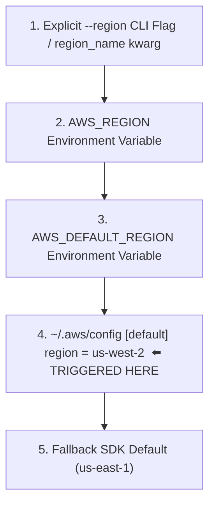
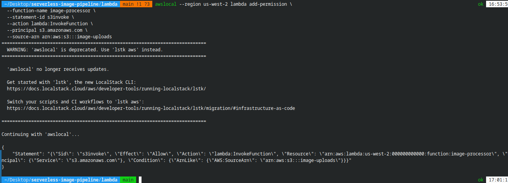

<div align="center">
  <a href="./00-phase-0-localstack-permission-crash.md">⬅️ Prev: Phase 0 — LocalStack Crash</a> &nbsp;|&nbsp;
  <a href="../../README.md">🏠 Back to Main README</a> &nbsp;|&nbsp;
  <a href="./02-phase-2-lambda-deployment-package.md">Next: Phase 2A — Lambda Deployment Package ➡️</a>
</div>

---

# Case Study 01: Silent AWS Region Drift & Configuration Mismatch (Phase 1)

| Field | Details |
| :--- | :--- |
| **Project** | Serverless Image Processing Pipeline |
| **Phase** | Phase 1 — Provisioning S3 Buckets & DynamoDB Table |
| **Environment** | Linux, LocalStack `3.0.2`, AWS CLI `2.36.0`, `awscli-local` |
| **Severity** | 🟠 **Medium / Latent Critical** (Silent locally, guaranteed `ResourceNotFoundException` in downstream services & real AWS) |
| **Time to Detect** | ~2 minutes after DynamoDB table creation (caught via ARN inspection) |
| **Status** | ✅ **Resolved** — Standardized entire stack on `us-west-2` |

---

## 1. Executive Summary

During Phase 1, the `ImageMetadata` DynamoDB table was created and reported `TableStatus: ACTIVE`. Every surface signal indicated success. However, careful inspection of the returned `TableArn` revealed that the table had been provisioned in **`us-west-2`** instead of the `us-east-1` region originally hardcoded in `docker-compose.yml`.

This represents a classic **silent configuration drift**: no command errored or warned, yet downstream services (Lambda and the Flask Dashboard) configured for `us-east-1` would later fail with `ResourceNotFoundException`—a failure that is notoriously misleading to debug because developers instinctively check table names and IAM permissions before suspecting region mismatch.

---

## 2. Incident Timeline

| Step | Action | Observed Signal | Assessment |
| :---: | :--- | :--- | :--- |
| **1** | `awslocal --version` | Deprecation notice (`awslocal` → `lstk aws`) + version output | ⚠️ Tool deprecated, but functional |
| **2** | `awslocal s3 mb s3://image-uploads` & `s3://image-thumbnails` | `make_bucket: image-uploads` | ✅ Buckets created |
| **3** | `awslocal dynamodb create-table --table-name ImageMetadata ...` | JSON response with `"TableStatus": "ACTIVE"` | ⚠️ Looked successful at a glance |
| **4** | Inspected full JSON `TableArn` field | `"arn:aws:dynamodb:us-west-2:000000000000:table/ImageMetadata"` | ❌ **Region drift detected (`us-west-2` vs `us-east-1`)** |
| **5** | Ran `aws configure get region` | Output: `us-west-2` | 🎯 Root cause located in `~/.aws/config` |
| **6** | Standardized project on `us-west-2` | Updated `docker-compose.yml`, shell env, and Python fallbacks | ✅ Full-stack region alignment |

---

## 3. Primary Incident — Silent Region Drift

### 3.1 Symptom
The DynamoDB `create-table` response returned:
```json
{
  "TableName": "ImageMetadata",
  "TableStatus": "ACTIVE",
  "TableArn": "arn:aws:dynamodb:us-west-2:000000000000:table/ImageMetadata",
  "KeySchema": [{ "AttributeName": "image_id", "KeyType": "HASH" }],
  "BillingModeSummary": { "BillingMode": "PAY_PER_REQUEST" }
}
```
Every attribute was valid except the region segment (`us-west-2`) compared to the `AWS_DEFAULT_REGION=us-east-1` setting in `docker-compose.yml`.

### 3.2 Why Silent Region Drift Is Dangerous
Region drift causes **deferred, misattributed runtime errors**:

| Downstream Stage | Resulting Error | Where Engineers Waste Time Looking First |
| :--- | :--- | :--- |
| **Phase 2 — Lambda writing to DynamoDB** | `ResourceNotFoundException` | IAM Role permissions, table name typos |
| **Phase 3 — Dashboard scanning DynamoDB** | `ResourceNotFoundException` / Empty table | Docker networking, container env vars |
| **Phase 4 — Real AWS S3 → Lambda Trigger** | `InvalidParameterValueException` | Cross-region S3 bucket notification restrictions |

### 3.3 Root Cause Analysis: AWS CLI Region Resolution Chain

The AWS CLI and `boto3` resolve the target region using a strict precedence hierarchy:



Because `awslocal` wraps the AWS CLI and no `--region` flag or `AWS_DEFAULT_REGION` variable was exported in the host shell, the CLI fell through to **Layer 4 (`~/.aws/config`)**, which had `region = us-west-2` configured on the developer workstation. Meanwhile, the Docker container had `AWS_DEFAULT_REGION=us-east-1` hardcoded in `docker-compose.yml`.

### 3.4 Architectural Fix

We standardized the entire project on **`us-west-2`** across all layers:

1. **Host Environment & AWS Config**:
   ```bash
   export AWS_DEFAULT_REGION=us-west-2
   aws configure set region us-west-2
   ```
2. **Docker Compose ([`docker-compose.yml`](../../docker-compose.yml))**:
   ```yaml
   environment:
     - AWS_DEFAULT_REGION=us-west-2
   ```
3. **Environment-Driven Python Code ([`lambda/app.py`](../../lambda/app.py) & [`dashboard/app.py`](../../dashboard/app.py))**:
   ```python
   REGION = os.environ.get("AWS_DEFAULT_REGION", "us-west-2")
   ```

---

## 4. Secondary Incidents Caught During Phase 1

### 4.1 Trailing Whitespace After Backslash (`\ `) in Multi-Line Shell Commands
- **Symptom**: A multi-line CLI command contained a trailing space after `\` on one line (`--attribute-definitions ... \ `).
- **Root Cause**: In Bash/Zsh, `\` followed immediately by a newline (`\n`) is a line continuation, whereas `\ ` (backslash + space) escapes the space character and terminates the command at the newline.
- **Prevention**: Avoid trailing spaces after `\` in shell scripts and CI workflows; validate scripts with `shellcheck`.

### 4.2 `awslocal` Deprecation Banner
- **Symptom**: Every `awslocal` invocation prints a deprecation banner recommending `lstk aws`:
  
- **Context**: `awscli-local` remains functional for LocalStack 3.0, while LocalStack transitions to the unified `lstk` CLI.

---

## 5. Key Engineering Lessons

1. **"Exit Code 0" ≠ "Intent Achieved"**: Reading the full output (specifically resource ARNs) caught a bug in 2 minutes that would have cost hours in Phase 3 or Phase 4.
2. **Enforce Region Explicitly at Every Layer**: Never rely on implicit CLI defaults. Pass `--region us-west-2` in scripts and read `os.environ.get("AWS_DEFAULT_REGION", "us-west-2")` in application code.
3. **Eliminate Hardcoded Environment Assumptions**: Using environment variables with sensible defaults allows identical code to run seamlessly in both LocalStack and real AWS.

---

<div align="center">
  <a href="./00-phase-0-localstack-permission-crash.md">⬅️ Prev: Phase 0 — LocalStack Crash</a> &nbsp;|&nbsp;
  <a href="../../README.md">🏠 Back to Main README</a> &nbsp;|&nbsp;
  <a href="./02-phase-2-lambda-deployment-package.md">Next: Case Study 02 — Lambda Deployment Package ➡️</a>
</div>
