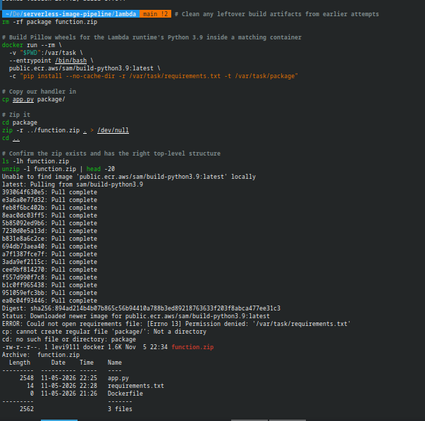
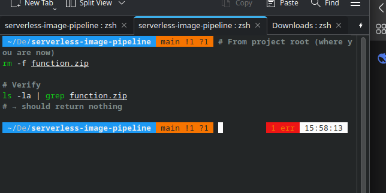
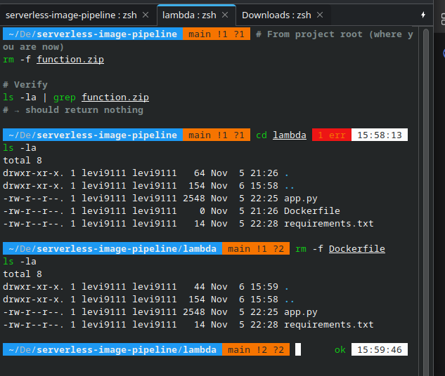
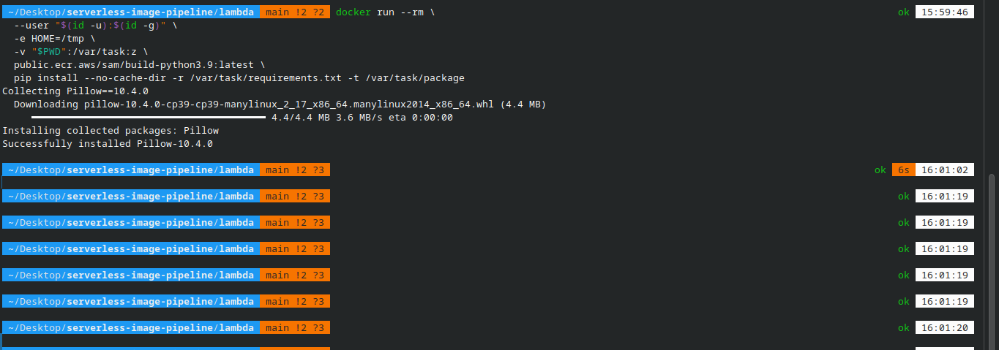
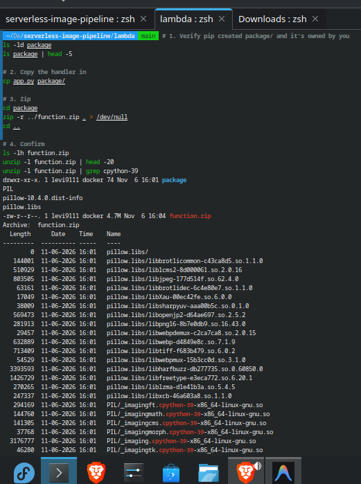

<div align="center">
  <a href="./01-phase-1-region-drift.md">⬅️ Prev: Phase 1 — Region Drift</a> &nbsp;|&nbsp;
  <a href="../../README.md">🏠 Back to Main README</a> &nbsp;|&nbsp;
  <a href="./03-phase-2-docker-permission-failures.md">Next: Phase 2B — Docker Permission Failures ➡️</a>
</div>

---

# Case Study 02: The Lambda Deployment Package (`function.zip`) — ABI Compatibility & Construction

| Field | Details |
| :--- | :--- |
| **Project** | Serverless Image Processing Pipeline |
| **Phase** | Phase 2A — Lambda Function Build & Packaging |
| **Topic** | Why AWS Lambda requires a self-contained zip artifact, CPython ABI matching (`cpython-39`), and container-isolated builds |
| **Artifact** | `lambda/function.zip` (`4.7 MB` compressed, `cpython-39-x86_64-linux-gnu` native shared libraries) |
| **Status** | ✅ **Verified & Deployed** |

---

## 1. Executive Summary

Before deploying the `image-processor` Lambda function, we built `function.zip` (`4.7 MB`) from a `2.5 KB` Python handler ([`lambda/app.py`](../../lambda/app.py)). A common engineering question is: *"Why can't we just upload `app.py` directly, and why is the zip 4.7 MB for 83 lines of Python?"*

**The short answer**: AWS Lambda micro-VMs (Firecracker) have **no `pip`, no compiler, and no persistent package cache at runtime**. Any third-party library with compiled C extensions—like **`Pillow==10.4.0`**—must be pre-bundled alongside user code. Furthermore, because the host workstation runs **Python 3.14** while the target Lambda runtime runs **Python 3.9 on Amazon Linux 2**, building on the host produces incompatible `cpython-314` binaries that fail at runtime with `Invalid ELF header` or `No module named '_imaging'`. We solved this by building inside `public.ecr.aws/sam/build-python3.9:latest`.

---

## 2. What AWS Lambda Provides vs. What Must Be Bundled

| Component | Provided by Lambda Runtime? | Action Required |
| :--- | :---: | :--- |
| Python Interpreter (`/var/lang/bin/python3.9`) | ✅ Yes | None |
| AWS SDK (`boto3` & `botocore`) | ✅ Yes | None — pre-installed in Python runtimes |
| Python Standard Library (`os`, `io`, `uuid`, `datetime`) | ✅ Yes | None |
| **Third-Party Libraries (`Pillow==10.4.0`)** | ❌ **No** | **Must be bundled in `function.zip`** |
| **Native C Shared Libraries (`libjpeg`, `libpng`, `libwebp`)** | ❌ **No** | **Must be bundled in `pillow.libs/` inside `function.zip`** |

---

## 3. Anatomy of `function.zip` (4.7 MB)

When AWS Lambda cold-starts, it unpacks `function.zip` directly into `/var/task/`:

```text
/var/task/ (Unpacked Root of function.zip)
├── app.py                                           # 2.5 KB — User handler (app.lambda_handler)
├── PIL/                                             # ~500 KB pure Python + ~3.8 MB compiled C extensions
│   ├── Image.py
│   ├── _imaging.cpython-39-x86_64-linux-gnu.so      # 3.1 MB — Core C imaging engine (ABI-locked to Python 3.9)
│   ├── _imagingft.cpython-39-x86_64-linux-gnu.so    # FreeType font rendering C extension
│   ├── _webp.cpython-39-x86_64-linux-gnu.so         # WebP codec C extension
│   └── __pycache__/*.cpython-39.pyc
├── pillow.libs/                                     # Shared Linux C libraries (.so)
│   ├── libjpeg-177d514f.so.62.4.0                   # 803 KB — Fast native JPEG codec
│   ├── libpng16-8b7e0db9.so.16.43.0                 # 281 KB — Native PNG codec
│   ├── libtiff-f683b479.so.6.0.2                    # 713 KB — Native TIFF codec
│   ├── libfreetype-e3eca772.so.6.20.1               # 1.4 MB — Font rendering
│   └── libharfbuzz-db277735.so.0.60850.0            # 3.4 MB — Text shaping engine
└── pillow-10.4.0.dist-info/                         # Package metadata
```

### The `cpython-39` ABI Contract

Every compiled C extension carries Python's **Application Binary Interface (ABI)** tag in its filename:

| Build Environment | Python Version | Resulting Binary Filename | Loads on Lambda `python3.9`? |
| :--- | :---: | :--- | :---: |
| Fedora Linux Host | `3.14` | `_imaging.cpython-314-x86_64-linux-gnu.so` | ❌ **Fails (`Unable to import module 'app'`)** |
| **`sam/build-python3.9` Container** | **`3.9`** | **`_imaging.cpython-39-x86_64-linux-gnu.so`** | ✅ **Loads cleanly** |

---

## 4. Build Process & Evidence

### 4.1 First Attempt — Permission Denied & Stale Zip Artifact
When we first ran the SAM build container without UID mapping or SELinux volume flags (`:z`), the container failed to read `/var/task/requirements.txt`, leaving behind a broken `1.6 KB` zip containing an empty `Dockerfile`:



<details>
<summary>📄 <strong>View Raw Log: <code>evidence/phase-2-build-FAILED-log.txt</code></strong></summary>

```text
ERROR: Could not open requirements file: [Errno 13] Permission denied: '/var/task/requirements.txt'
cp: cannot create regular file 'package/': Not a directory
cd: no such file or directory: package
-rw-r--r--. 1 levi9111 docker 1.6K Nov  5 22:34 function.zip
Archive:  function.zip
  Length      Date    Time    Name
---------  ---------- -----   ----
     2548  11-05-2026 22:25   app.py
       14  11-05-2026 22:28   requirements.txt
        0  11-05-2026 21:26   Dockerfile
```
</details>

---

### 4.2 Workspace Cleanup
We removed the stale root `function.zip` and unused `lambda/Dockerfile` so the directory contained only [`app.py`](../../lambda/app.py) and [`requirements.txt`](../../lambda/requirements.txt):

| Root Cleanup (`phase-2-root-cleanup.png`) | Lambda Folder Cleanup (`phase-2-cleanup.png`) |
| :---: | :---: |
|  |  |

---

### 4.3 Successful Containerized Wheel Installation
By passing `--user "$(id -u):$(id -g)"`, `-e HOME=/tmp`, and `-v "$PWD":/var/task:z`, `pip` downloaded and extracted `pillow-10.4.0-cp39-cp39-manylinux_2_17_x86_64.whl` cleanly into `lambda/package/`:



<details>
<summary>📄 <strong>View Raw Log: <code>evidence/phase-2-build-success-log.txt</code></strong></summary>

```text
docker run --rm \
  --user "$(id -u):$(id -g)" \
  -e HOME=/tmp \
  -v "$PWD":/var/task:z \
  public.ecr.aws/sam/build-python3.9:latest \
  pip install --no-cache-dir -r /var/task/requirements.txt -t /var/task/package

Collecting Pillow==10.4.0
  Downloading pillow-10.4.0-cp39-cp39-manylinux_2_17_x86_64.manylinux2014_x86_64.whl (4.4 MB)
Installing collected packages: Pillow
Successfully installed Pillow-10.4.0
```
</details>

---

### 4.4 Packaging & ABI Verification (`phase-2-build-package.png`)
Next, `app.py` was copied into `package/` and zipped from inside `package/` so `app.py` sits at the root of `function.zip`:



<details>
<summary>📄 <strong>View Raw Log: <code>evidence/phase-2-build-package-log.txt</code> (Excerpt)</strong></summary>

```text
drwxr-xr-x. 1 levi9111 docker 74 Nov  6 16:01 package
PIL
pillow-10.4.0.dist-info
pillow.libs
-rw-r--r--. 1 levi9111 docker 4.7M Nov  6 16:04 function.zip
Archive:  function.zip
  Length      Date    Time    Name
---------  ---------- -----   ----
        0  11-06-2026 16:01   pillow.libs/
   803505  11-06-2026 16:01   pillow.libs/libjpeg-177d514f.so.62.4.0
  3176777  11-06-2026 16:01   PIL/_imaging.cpython-39-x86_64-linux-gnu.so
```
</details>

---

## 5. Verification Gate Checklist

Before running `create-function`, our `function.zip` passed all 7 deployment gates:

| # | Gate Check | Verification Command | Result |
| :---: | :--- | :--- | :--- |
| **1** | Handler file at archive root | `unzip -l function.zip \| grep ' app\.py$'` | `app.py` at root ✅ |
| **2** | Target ABI matches `python3.9` | `unzip -l function.zip \| grep cpython-39` | `*.cpython-39-x86_64-linux-gnu.so` ✅ |
| **3** | No host Python 3.14 binaries | `unzip -l function.zip \| grep cpython-314` | `0` matches ✅ |
| **4** | Expected package size | `ls -lh function.zip` | `4.7M` ✅ |
| **5** | Non-root file ownership | `ls -ld package/` | Owned by `levi9111` ✅ |
| **6** | No stray `Dockerfile` | `unzip -l function.zip \| grep Dockerfile` | `0` matches ✅ |
| **7** | Handler string alignment | `--handler app.lambda_handler` | Matches `app.py` `def lambda_handler` ✅ |

---

<div align="center">
  <a href="./01-phase-1-region-drift.md">⬅️ Prev: Phase 1 — Region Drift</a> &nbsp;|&nbsp;
  <a href="../../README.md">🏠 Back to Main README</a> &nbsp;|&nbsp;
  <a href="./03-phase-2-docker-permission-failures.md">Next: Case Study 03 — Docker Permission Failures ➡️</a>
</div>
