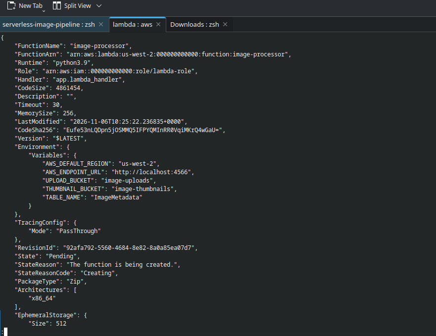
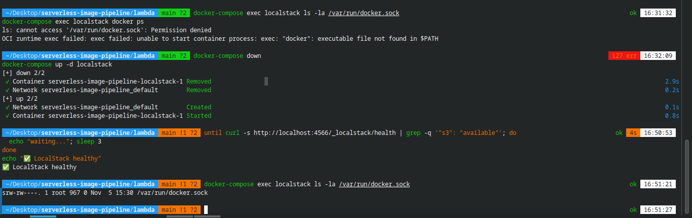
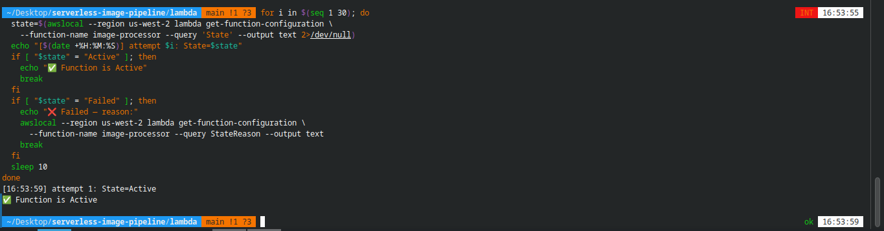

<div align="center">
  <a href="./02-phase-2-lambda-deployment-package.md">⬅️ Prev: Phase 2A — Lambda Package</a> &nbsp;|&nbsp;
  <a href="../../README.md">🏠 Back to Main README</a> &nbsp;|&nbsp;
  <a href="./04-phase-2-pipeline-working.md">Next: Phase 2C — End-to-End Pipeline Working ➡️</a>
</div>

---

# Case Study 03: Two Host–Container Docker Permission Failures in Phase 2

| Field | Details |
| :--- | :--- |
| **Project** | Serverless Image Processing Pipeline |
| **Phase** | Phase 2B — Lambda Build & Runtime Container Spawning |
| **Environment** | Fedora Linux (SELinux Enforcing), Docker Compose V2, LocalStack `3.0.2` |
| **Severity** | 🔴 **Blocker** (`State: Failed` — `"Error while creating lambda: Docker not available"`) |
| **Time to Resolve** | ~30 minutes across both incidents |
| **Status** | ✅ **Resolved** — Function transitioned from `Pending` → `Active` on first poll |

---

## 1. Executive Summary

Phase 2 encountered two related permission failures caused by **host↔container security boundaries on an SELinux-enforcing Linux host**:
1. **Build-Time Failure**: The AWS SAM build container could not read `requirements.txt` or write `package/` on the bind-mounted host directory.
2. **Runtime Failure**: LocalStack accepted `awslocal lambda create-function` (`State: Pending`), but seconds later transitioned the function to `State: Failed` with `StateReason: "Error while creating lambda: Docker not available"`.

Although the symptoms looked completely different, both shared the same underlying root cause: **Fedora's SELinux mandatory access control blocked container processes from accessing mounted host resources (`./lambda` and `/var/run/docker.sock`) until explicitly permitted.**

---

## 2. Incident Timeline

| Step | Action | Observed Signal | Assessment |
| :---: | :--- | :--- | :--- |
| **1** | Build Pillow inside SAM container (`-v "$PWD":/var/task`) | `Permission denied: '/var/task/requirements.txt'` | ❌ SELinux blocked bind mount |
| **2** | Rebuild with `--user $(id -u):$(id -g) -e HOME=/tmp -v "$PWD":/var/task:z` | `function.zip` (`4.7 MB`) created | ✅ Build fixed |
| **3** | `awslocal lambda create-function ...` | Returned `"State": "Pending"` | ⏳ Asynchronous container setup |
| **4** | Polled `get-function-configuration` | `"State": "Failed"`, `"StateReason": "Docker not available"` | ❌ LocalStack couldn't talk to Docker daemon |
| **5** | `docker-compose exec localstack ls -la /var/run/docker.sock` | `ls: cannot access '/var/run/docker.sock': Permission denied` | 🎯 SELinux blocking `stat()` on socket |
| **6** | Added `security_opt: [label=disable]` to `localstack` in `docker-compose.yml` | `srw-rw----. 1 root 967 0 ... /var/run/docker.sock` | ✅ Socket accessible |
| **7** | Re-ran `create-function` & polled state | `attempt 1: State=Active` | ✅ Lambda runtime container ready |

---

## 3. Incident Analysis: LocalStack Cannot Spawn Lambda Runtime Container

### 3.1 Initial `create-function` Output (`State: Pending`)
When `create-function` was first executed, LocalStack returned HTTP 200 with `"State": "Pending"`:



<details>
<summary>📄 <strong>View Raw Log: <code>evidence/phase-2-function-config-log.txt</code></strong></summary>

```json
{
    "FunctionName": "image-processor",
    "FunctionArn": "arn:aws:lambda:us-west-2:000000000000:function:image-processor",
    "Runtime": "python3.9",
    "Handler": "app.lambda_handler",
    "CodeSize": 4861454,
    "MemorySize": 256,
    "State": "Pending",
    "StateReason": "The function is being created.",
    "StateReasonCode": "Creating"
}
```
</details>

### 3.2 Diagnostic Breakthrough (`/var/run/docker.sock`)
Seconds after `Pending`, the state flipped to `Failed` with:
```json
{
  "State": "Failed",
  "StateReason": "Error while creating lambda: Docker not available",
  "StateReasonCode": "InternalError"
}
```
Testing socket access from inside the running LocalStack container revealed the smoking gun:

```bash
docker-compose exec localstack ls -la /var/run/docker.sock
# Output:
# ls: cannot access '/var/run/docker.sock': Permission denied
```

**Why this happens**:
- LocalStack executes Lambda functions by calling the host Docker API over `/var/run/docker.sock` to spawn a sibling container (`public.ecr.aws/lambda/python:3.9`).
- When `stat()` itself fails with `Permission denied` on a mounted socket, it is **not** a standard Unix UID/GID issue—it is **SELinux confinement** (`container_t` is forbidden from accessing the host's `docker_var_run_t` socket label).

### 3.3 The Fix & Verification
We added `security_opt: [label=disable]` to the `localstack` service in [`docker-compose.yml`](../../docker-compose.yml):

```yaml
services:
  localstack:
    image: localstack/localstack:3.0
    volumes:
      - "./localstack_data:/var/lib/localstack"
      - "/var/run/docker.sock:/var/run/docker.sock"
    security_opt:
      - label=disable
```

After restarting LocalStack, `/var/run/docker.sock` was immediately accessible inside the container:



Re-creating the Lambda function and polling its status confirmed `State=Active` on the first attempt:



<details>
<summary>📄 <strong>View Raw Log: <code>evidence/phase-2-lambda-ACTIVE-log.txt</code></strong></summary>

```text
for i in $(seq 1 30); do
  state=$(awslocal --region us-west-2 lambda get-function-configuration \
    --function-name image-processor --query 'State' --output text 2>/dev/null)
  echo "[$(date +%H:%M:%S)] attempt $i: State=$state"
  if [ "$state" = "Active" ]; then
    echo "✅ Function is Active"
    break
  fi
  sleep 10
done
[16:53:59] attempt 1: State=Active
✅ Function is Active
```
</details>

---

## 4. Pattern Recognition: Three SELinux Boundary Encounters

| Phase | Host Resource Mounted | Target Container | Symptom When Blocked | Targeted Fix |
| :---: | :--- | :--- | :--- | :--- |
| **Phase 0** | `./localstack_data/` | `localstack` | `mkdir: ... Permission denied` | `chmod 777` + `:z` mount flag |
| **Phase 2A** | `./lambda/` | `sam/build-python3.9` | `Permission denied: '/var/task/requirements.txt'` | `--user $(id -u):$(id -g)` + `:z` mount flag |
| **Phase 2B** | `/var/run/docker.sock` | `localstack` | `StateReason: "Docker not available"` | `security_opt: [label=disable]` |

> [!IMPORTANT]
> Never relabel `/var/run/docker.sock` with `:z`—doing so changes the host socket's SELinux label and can break the host Docker daemon. Using `security_opt: [label=disable]` on the LocalStack container is the safe, targeted solution.

---

<div align="center">
  <a href="./02-phase-2-lambda-deployment-package.md">⬅️ Prev: Phase 2A — Lambda Package</a> &nbsp;|&nbsp;
  <a href="../../README.md">🏠 Back to Main README</a> &nbsp;|&nbsp;
  <a href="./04-phase-2-pipeline-working.md">Next: Case Study 04 — End-to-End Pipeline Working ➡️</a>
</div>
