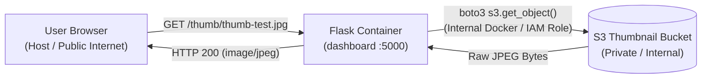
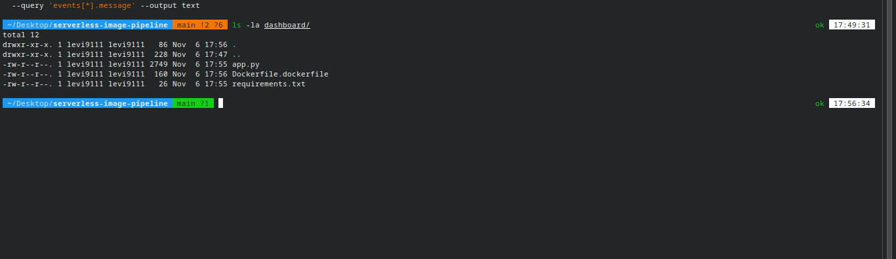
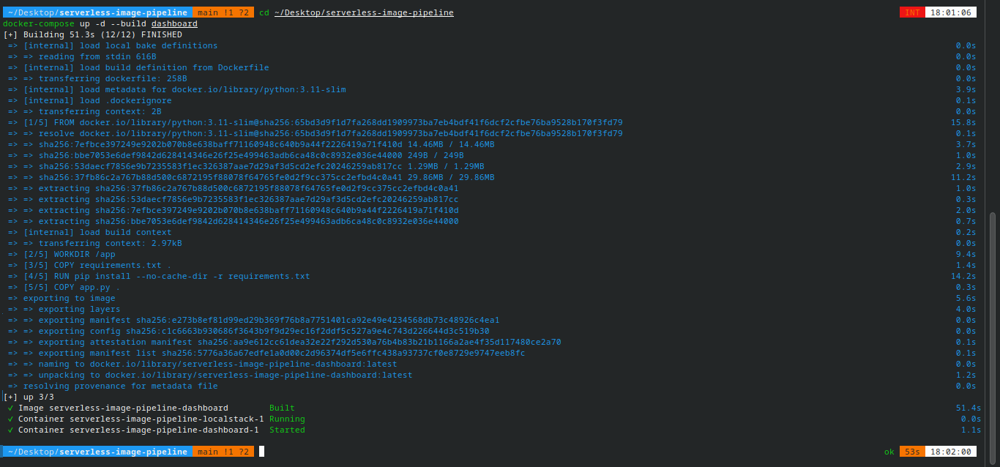
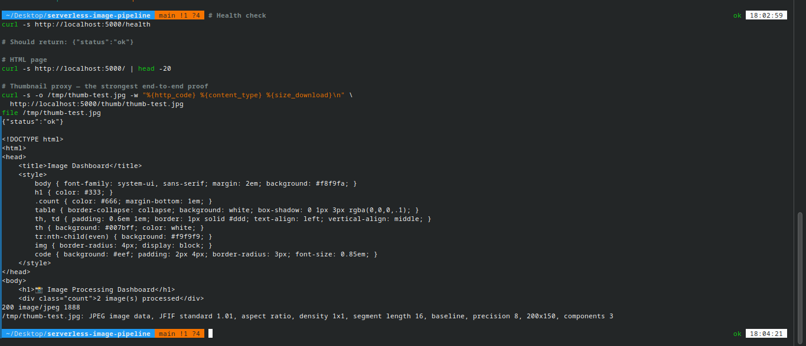
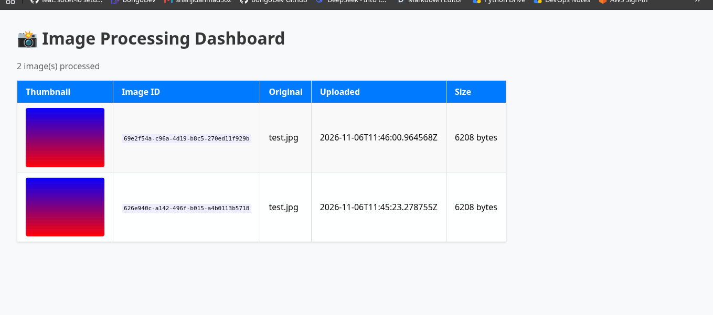

<div align="center">
  <a href="./04-phase-2-pipeline-working.md">⬅️ Prev: Phase 2C — Pipeline Working</a> &nbsp;|&nbsp;
  <a href="../../README.md">🏠 Back to Main README</a> &nbsp;|&nbsp;
  <a href="./05-phase-4-real-aws-errors.md">Next: Phase 4A — Real AWS Migration ➡️</a>
</div>

---

# Case Study 05: Containerized Flask Dashboard & S3 Thumbnail Proxy Pattern (Phase 3)

| Field | Details |
| :--- | :--- |
| **Project** | Serverless Image Processing Pipeline |
| **Phase** | Phase 3 — Backend API & Dashboard Containerization |
| **Environment** | Python `3.11-slim`, Flask `3.0.0`, `boto3`, Docker Compose (`localstack-net`) |
| **Key Pattern** | Backend Media Stream Proxy (`/thumb/<key>` → `s3.get_object`) vs. S3 Presigned URLs |
| **Status** | ✅ **Resolved & Verified** |

---

## 1. Executive Summary

In Phase 3, we built and containerized the **Flask Dashboard & REST API** (`dashboard/`) to query processed image records from DynamoDB (`ImageMetadata`) and serve thumbnail images from S3 (`image-thumbnails`).

Two critical architectural and operational lessons emerged during this phase:
1. **Why S3 Proxying Beat Presigned URLs**: In a split-network topology (where the user's browser runs on the host/internet, while the Flask container and LocalStack communicate over an internal Docker bridge network `http://localstack:4566`, or where real AWS S3 buckets block public access), S3 presigned URLs fail or require public bucket exposure. Streaming thumbnails through a backend proxy route (`/thumb/<key>`) works identically across LocalStack and locked-down production AWS buckets.
2. **Dockerfile Naming Contract**: An initial `Dockerfile.dockerfile` naming mistake caused `docker-compose up --build` to fail until standardized to `dashboard/Dockerfile`.

---

## 2. Architectural Decision: Backend Proxy (`/thumb/<key>`) vs. Direct S3 URLs



### Why Direct or Presigned S3 URLs Fail in Hybrid Topologies:
- **In LocalStack**: Generating a presigned URL inside the `dashboard` container produces `http://localstack:4566/image-thumbnails/thumb-test.jpg?...`. The host browser cannot resolve the internal Docker DNS hostname `localstack`.
- **In Production AWS**: By default, S3 buckets enforce **Block Public Access**. Serving thumbnails via `/thumb/<path:key>` allows the S3 bucket to remain **100% private**, while the Flask container fetches objects securely using its IAM Role.

---

## 3. Build & Verification Evidence

### 3.1 Fixing `Dockerfile.dockerfile` → `Dockerfile` (`phase-3-dashboard-files.png`)
Initially, the file inside `dashboard/` was named `Dockerfile.dockerfile` (`phase-3-dashboard-files.png`), which caused Docker Compose to fail with `failed to read dockerfile: open Dockerfile: no such file or directory`. Renaming it to `Dockerfile` resolved the issue immediately:



---

### 3.2 Building the `python:3.11-slim` Dashboard Image (`phase-3-dashboard-built.png`)
Running `docker-compose up -d --build dashboard` built the image in `51.3s` and attached it to `localstack-net`:



<details>
<summary>📄 <strong>View Raw Log: <code>evidence/phase-3-dashboard-built-log.txt</code></strong></summary>

```text
docker-compose up -d --build dashboard
[+] Building 51.3s (12/12) FINISHED
 => [1/5] FROM docker.io/library/python:3.11-slim@sha256:65bd3d9f...  15.8s
 => [2/5] WORKDIR /app                                                 9.4s
 => [3/5] COPY requirements.txt .                                      1.4s
 => [4/5] RUN pip install --no-cache-dir -r requirements.txt          14.2s
 => [5/5] COPY app.py .                                                0.3s
 => exporting to image                                                 5.6s
[+] up 3/3
 ✔ Image serverless-image-pipeline-dashboard        Built             51.4s
 ✔ Container serverless-image-pipeline-localstack-1 Running            0.0s
 ✔ Container serverless-image-pipeline-dashboard-1  Started
```
</details>

---

### 3.3 CLI Health & Thumbnail Proxy Verification (`phase-3-cli-tests.png`)
Before opening a browser, we verified the container endpoints from the terminal:
1. `GET /health` returned `{"status":"ok"}`.
2. `GET /` rendered the HTML table with `2 image(s) processed`.
3. `GET /thumb/thumb-test.jpg` returned HTTP `200`, `content-type: image/jpeg`, `1888` bytes, verified by `file` as `JPEG image data, JFIF standard 1.01, 200x150`:



---

### 3.4 Browser Verification (`phase-3-browser-view.png`)
Opening `http://localhost:5000` rendered the processed thumbnails and DynamoDB metadata rows cleanly:



---

## 4. Evolution to Decoupled REST API (`Phase 4`)

In Phase 4, [`dashboard/app.py`](../../dashboard/app.py) was upgraded with `flask-cors` (`CORS(app)`) and a dedicated JSON endpoint (`GET /api/images`) so the standalone **React + TypeScript + Tailwind CSS + GSAP Admin Console** (`frontend/`) can consume metadata via REST while still streaming thumbnails from `/thumb/<path:key>`.

---

<div align="center">
  <a href="./04-phase-2-pipeline-working.md">⬅️ Prev: Phase 2C — Pipeline Working</a> &nbsp;|&nbsp;
  <a href="../../README.md">🏠 Back to Main README</a> &nbsp;|&nbsp;
  <a href="./05-phase-4-real-aws-errors.md">Next: Case Study 06 — Real AWS Migration ➡️</a>
</div>
