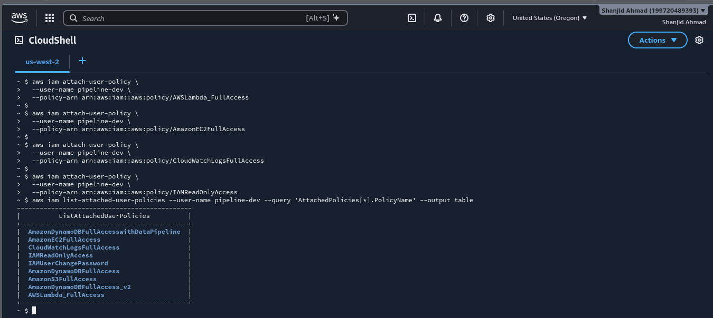
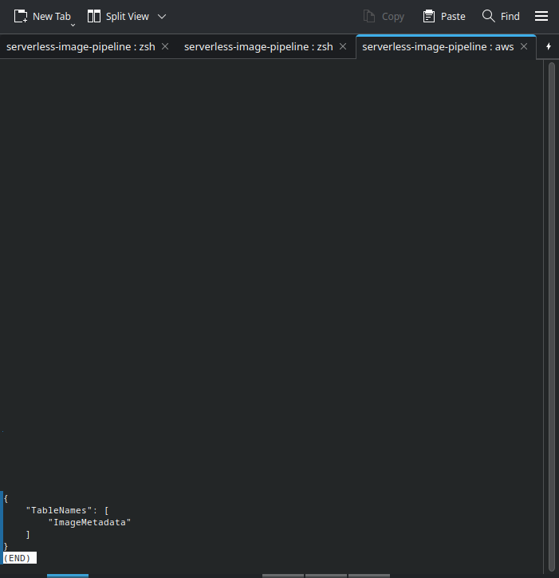
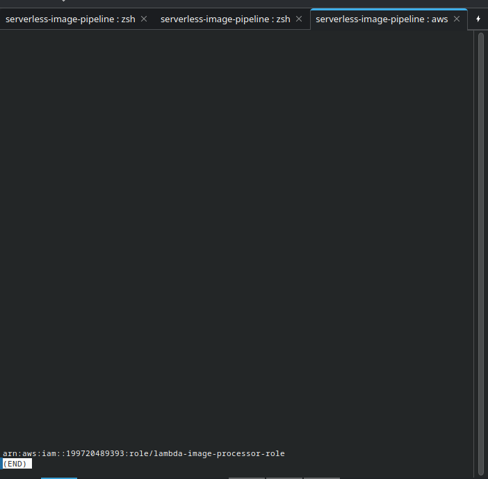
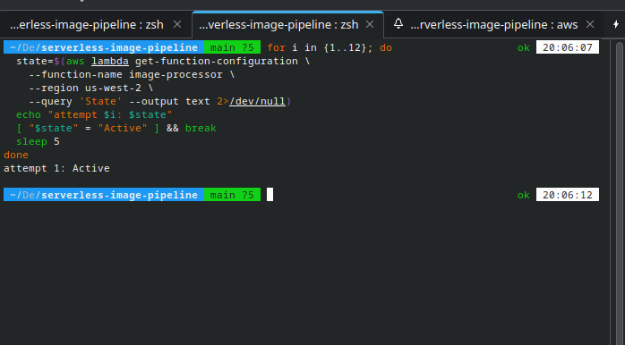
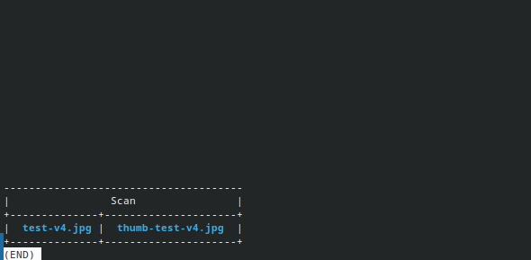
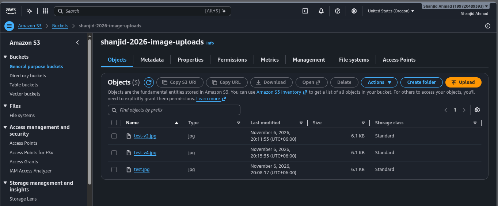
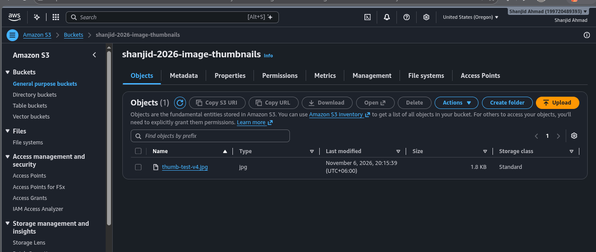
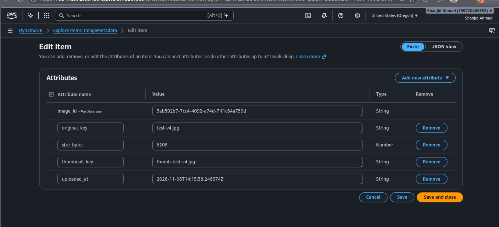

<div align="center">
  <a href="./05-phase-3-dashboard.md">⬅️ Prev: Phase 3 — Flask S3 Proxy Dashboard</a> &nbsp;|&nbsp;
  <a href="../../README.md">🏠 Back to Main README</a> &nbsp;|&nbsp;
  <a href="./06-phase-4-iam-and-ec2.md">Next: Phase 4B — IAM Instance Profiles & EC2 ➡️</a>
</div>

---

# Case Study 06: Migrating from LocalStack to Real AWS — 5 Security & Platform Realities (Phase 4A)

| Field | Details |
| :--- | :--- |
| **Project** | Serverless Image Processing Pipeline |
| **Phase** | Phase 4A — Real AWS Cloud Deployment (`us-west-2`) |
| **AWS Services** | Amazon S3 (`shanjid-2026-image-uploads`, `shanjid-2026-image-thumbnails`), AWS Lambda (`image-processor`), Amazon DynamoDB (`ImageMetadata`), AWS IAM, AWS CloudShell |
| **Outcome** | ✅ **Resolved** — Full event-driven serverless pipeline running in production AWS |

---

## 1. Executive Summary

Moving from LocalStack to real AWS exposed critical differences in **security boundaries, IAM bootstrapping, and platform defaults**. While LocalStack is intentionally permissive (accepting dummy `test`/`test` credentials, arbitrary environment variables, and open S3 ACLs), real AWS enforces **Deny-by-Default** security across every API call.

During the migration, we encountered and resolved **five distinct production blockers**, each illustrating a core AWS security principle.

---

## 2. Summary of the 5 Real-AWS Blockers & Resolutions

| # | Incident | Error / Symptom | Root Cause | Resolution |
| :---: | :--- | :--- | :--- | :--- |
| **1** | **IAM User Self-Bootstrapping** | `AccessDenied` when running `aws iam attach-user-policy` locally | IAM user `pipeline-dev` cannot grant permissions to itself without `iam:AttachUserPolicy` | Opened **AWS CloudShell** as Root and attached required managed policies |
| **2** | **IAM Console Filter Trap** | Searching `AWSLambda_FullAccess` showed `0 matches` | Console filter defaulted to *Customer managed* instead of *AWS managed* policies | Attached policies directly via AWS CloudShell CLI |
| **3** | **Missing `iam:CreateRole`** | `AccessDenied` when creating `lambda-image-processor-role` | `IAMReadOnlyAccess` permits listing roles, not creating them | Attached `IAMFullAccess` during provisioning |
| **4** | **Reserved Lambda Env Var** | `InvalidParameterValueException` on `create-function` | Passed `AWS_DEFAULT_REGION=us-west-2` in `--environment`; AWS reserves `AWS_*` keys | Removed `AWS_DEFAULT_REGION` from `--environment` (Lambda injects it automatically) |
| **5** | **S3 Public ACL Block** | Lambda failed with `AccessControlListNotSupported` | Real S3 buckets enforce `BucketOwnerEnforced` (ACLs disabled); `app.py` had `ACL="public-read"` | Removed `ACL="public-read"` from `s3.put_object()` in [`lambda/app.py`](../../lambda/app.py), rebuilt `function.zip`, and updated Lambda |

---

## 3. Step-by-Step Deployment & Verification Evidence

### 3.1 Bootstrapping `pipeline-dev` via AWS CloudShell (`phase-4-iam-cloudshell-success.png`)
When local CLI commands failed with `AccessDenied` due to IAM bootstrapping restrictions, we used **AWS CloudShell** in `us-west-2` to attach the required policies (`AWSLambda_FullAccess`, `AmazonEC2FullAccess`, `CloudWatchLogsFullAccess`, `AmazonS3FullAccess`, `AmazonDynamoDBFullAccess`) and verified the attached policy table:



---

### 3.2 Provisioning Real DynamoDB & IAM Execution Role
With permissions active, we created the production DynamoDB table `ImageMetadata` and the Lambda execution role (`arn:aws:iam::199720489393:role/lambda-image-processor-role`) using [`trust-policy.json`](../../trust-policy.json) and least-privilege [`lambda-permissions.json`](../../lambda-permissions.json):

| Real DynamoDB Table Created (`phase-4-real-resources-created.png`) | Lambda Execution Role ARN (`phase-4-lambda-role-created.png`) |
| :---: | :---: |
|  |  |

---

### 3.3 Deploying Lambda to Real AWS (`phase-4-lambda-active-aws.png`)
After removing the reserved `AWS_DEFAULT_REGION` key from the `--environment` block, `aws lambda create-function` succeeded and reached `State: Active` on the first poll:



---

### 3.4 Fixing `AccessControlListNotSupported` & Verifying Production Execution
On the first real S3 upload, tailing CloudWatch logs (`aws logs tail /aws/lambda/image-processor --follow`) revealed:
```text
botocore.exceptions.ClientError: An error occurred (AccessControlListNotSupported) when calling the PutObject operation: The bucket does not allow ACLs
```
Because modern AWS S3 buckets disable ACLs by default (`ObjectOwnership: BucketOwnerEnforced`), we removed `ACL="public-read"` from `s3.put_object()` in `lambda/app.py`, rebuilt `function.zip`, and updated the function code.

Uploading `test-v4.jpg` (`6.1 KB`) to `s3://shanjid-2026-image-uploads/` immediately triggered Lambda, created `thumb-test-v4.jpg` (`1.8 KB`), and wrote the metadata item to DynamoDB:



---

### 3.5 AWS Management Console Verification Across S3 & DynamoDB

| 1. Source Upload Bucket (`shanjid-2026-image-uploads`) | 2. Generated Thumbnail Bucket (`shanjid-2026-image-thumbnails`) |
| :---: | :---: |
|  |  |

**3. Real DynamoDB `ImageMetadata` Item Inspection (`phase-4-aws-console-verification.png`):**



---

## 4. Key Engineering Lessons

1. **Real AWS Is "Deny by Default"**: LocalStack optimizes for developer speed; AWS optimizes for zero-trust isolation. Every cross-service interaction (`S3` → `Lambda`, `Lambda` → `S3`, `Lambda` → `DynamoDB`) requires explicit IAM trust and permission policies.
2. **Modern S3 Disables ACLs (`BucketOwnerEnforced`)**: Never use `ACL='public-read'` on `put_object` in modern AWS. Use bucket policies (when public access is intentional) or backend IAM-authenticated proxies (like our Flask `/thumb/<key>` endpoint).
3. **`aws logs tail --follow` Is Indispensable**: Asynchronous S3-triggered Lambda failures do not surface in the terminal that ran `aws s3 cp`. Tailing the CloudWatch log group in real time pinpointed `AccessControlListNotSupported` in seconds.

---

<div align="center">
  <a href="./05-phase-3-dashboard.md">⬅️ Prev: Phase 3 — Flask S3 Proxy Dashboard</a> &nbsp;|&nbsp;
  <a href="../../README.md">🏠 Back to Main README</a> &nbsp;|&nbsp;
  <a href="./06-phase-4-iam-and-ec2.md">Next: Case Study 07 — IAM Instance Profiles & EC2 ➡️</a>
</div>
