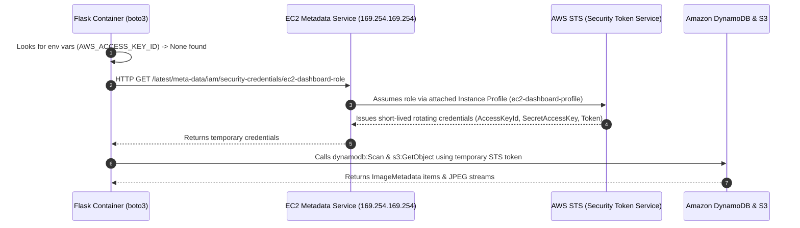
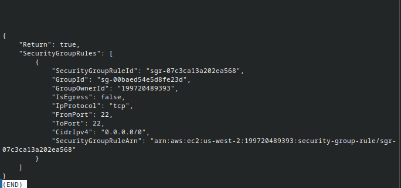
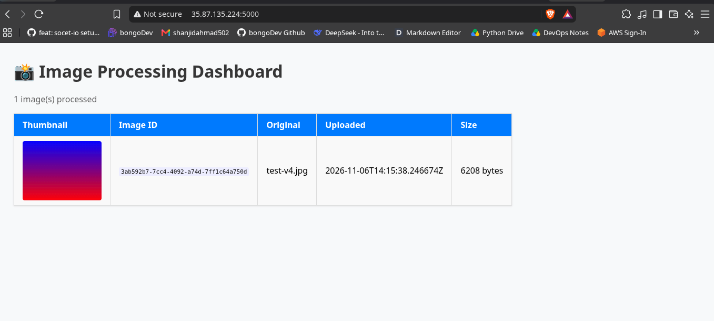
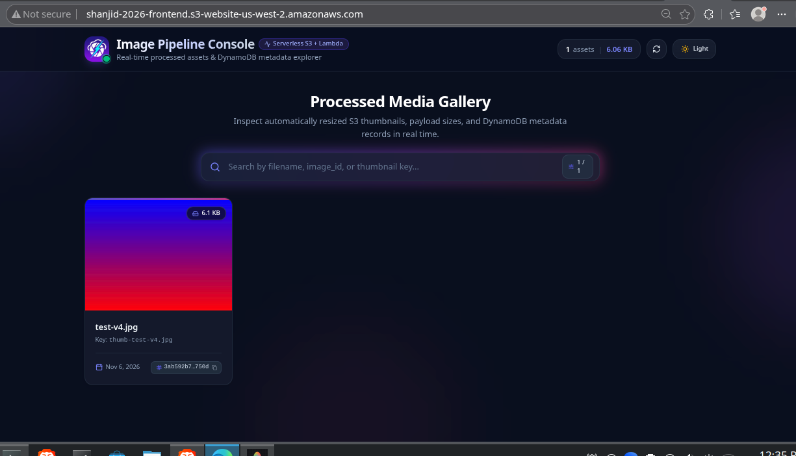

  <a href="./05-phase-4-real-aws-errors.md">⬅️ Prev: Phase 4A — Real AWS Migration</a> &nbsp;|&nbsp;
  <a href="../../README.md">🏠 Back to Main README</a> &nbsp;|&nbsp;
  <a href="../architecture.md">🏗️ System Architecture ➡️</a>

---

# Case Study 07: EC2 Deployment, IAM Instance Profiles (IMDS), & Live React Console (Phase 4B)

| Field | Details |
| :--- | :--- |
| **Project** | Serverless Image Processing Pipeline |
| **Phase** | Phase 4B — Production API Hosting on EC2 & S3 React Frontend Deployment |
| **AWS Services** | Amazon EC2 (`i-011898b03051e8d61`), Security Groups (`sg-00baed54e5d8fe23d`), IAM Instance Profile (`ec2-dashboard-profile`), Amazon S3 Static Website Hosting (`shanjid-2026-frontend`) |
| **Outcome** | ✅ **Resolved** — Keyless EC2 Docker backend + Live React Admin Console on AWS |

---

## 1. Executive Summary

After deploying the serverless core (`S3` → `Lambda` → `DynamoDB`) to real AWS, we deployed the containerized **Flask REST API** onto an **Amazon EC2 instance** (`35.87.135.224:5000`) and hosted the **React + TypeScript + Tailwind CSS + GSAP Admin Console** on **Amazon S3 Static Website Hosting** (`shanjid-2026-frontend`).

Crucially, **no AWS access keys (`AWS_ACCESS_KEY_ID` / `AWS_SECRET_ACCESS_KEY`) were passed into the EC2 Docker container**. Instead, the container authenticates dynamically via an **IAM Instance Profile** and the **EC2 Instance Metadata Service (IMDS)**.

---

## 2. Deep Dive: How Docker on EC2 Authenticates to AWS Without Static Keys

### Why This Matters for Production Security
- **Zero Static Secret Leakage**: If an image is pushed to Docker Hub or a container log is exposed, there are no long-lived AWS keys to steal.
- **Automatic Credential Rotation**: AWS STS rotates the temporary session tokens automatically before expiration.
- **Least-Privilege Scope**: The role policy ([`ec2-permissions.json`](../../ec2-permissions.json)) grants **only** `dynamodb:Scan` on `ImageMetadata` and `s3:GetObject` on `shanjid-2026-image-thumbnails/*`.

---

## 3. Blockers Resolved During EC2 & Frontend Rollout

| # | Incident | Symptom | Root Cause | Resolution |
| :---: | :--- | :--- | :--- | :--- |
| **1** | **Empty Instance Profile Dropdown** | EC2 Console didn't list `ec2-dashboard-role` | EC2 attaches *Instance Profiles*, not IAM Roles directly via CLI | Created `ec2-dashboard-profile` and ran `aws iam add-role-to-instance-profile` |
| **2** | **Leftover LocalStack Endpoint** | `500 Internal Server Error` on EC2 | `AWS_ENDPOINT_URL` was still pointing to `http://localstack:4566` | Made `AWS_ENDPOINT_URL` optional (`os.environ.get("AWS_ENDPOINT_URL")`) so `boto3` uses real AWS endpoints when unset |
| **3** | **EC2 IAM `AccessDenied` on Scan** | `assumed-role/ec2-dashboard-role is not authorized to perform: dynamodb:Scan` | Role existed, but inline policy (`ec2-permissions.json`) hadn't been attached | Executed `aws iam put-role-policy` with [`ec2-permissions.json`](../../ec2-permissions.json) |
| **4** | **CORS Blocked Between S3 & EC2** | React frontend on S3 failed to fetch `http://35.87.135.224:5000/api/images` | Browser blocked cross-origin request from S3 website origin to EC2 `:5000` | Added `flask-cors` (`CORS(app)`) in [`dashboard/app.py`](../../dashboard/app.py) |

---

## 4. Production Deployment Evidence

### 4.1 Security Group Configuration (`Screenshot_20261106_202539.png`)
Configured EC2 Security Group (`sg-00baed54e5d8fe23d`) inbound rules to permit SSH (`22`) for GitHub Actions deployment and TCP (`5000`) for the Flask REST API:

---

### 4.2 Initial EC2 Verification (`phase-4-ec2-dashboard-live.png`)
Verified that the Docker container running on EC2 (`http://35.87.135.224:5000`) could query the production `ImageMetadata` table and proxy `test-v4.jpg` from `shanjid-2026-image-thumbnails` using its IAM Instance Profile:

---

### 4.3 Final Production React Admin Console Live on AWS S3 (`phase-4-final-react-dashboard-live.png`)
Finally, the React + TypeScript + Tailwind CSS + GSAP frontend was built and deployed to `http://shanjid-2026-frontend.s3-website-us-west-2.amazonaws.com`, fetching live data from EC2 (`35.87.135.224:5000`):

---

  <a href="./05-phase-4-real-aws-errors.md">⬅️ Prev: Phase 4A — Real AWS Migration</a> &nbsp;|&nbsp;
  <a href="../../README.md">🏠 Back to Main README</a> &nbsp;|&nbsp;
  <a href="../architecture.md">🏗️ System Architecture ➡️</a>

