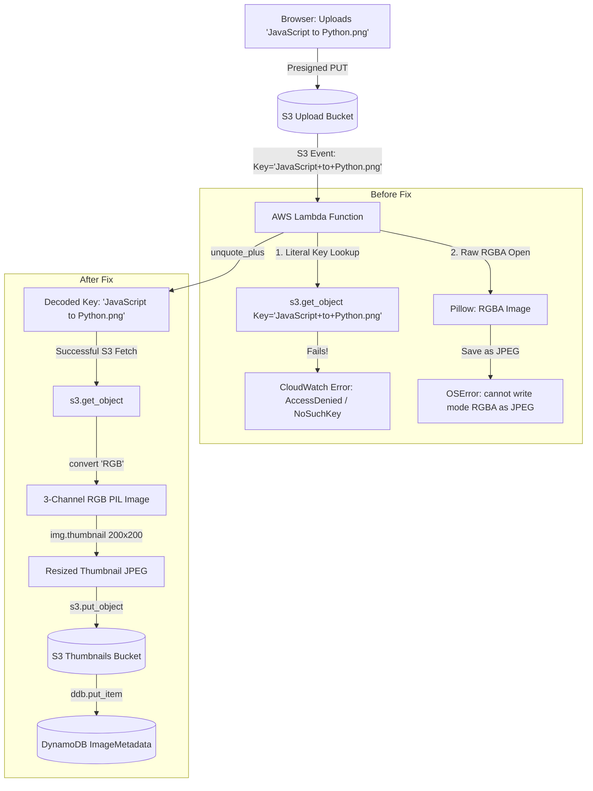

<div align="center">
  <a href="./06-phase-4-iam-and-ec2.md">⬅️ Prev: Phase 4B — EC2 Deployment & IAM</a> &nbsp;|&nbsp;
  <a href="../../README.md">🏠 Back to Main README</a> &nbsp;|&nbsp;
  <a href="./07-phase-6-cicd-oidc-errors.md">Next: Phase 6 — CI/CD & OIDC Authentication ➡️</a>
</div>

---

# Case Study 08: Lambda Image Processing Bugs — URL-Encoded Keys & RGBA Alpha Transparency

| Field                 | Details                                                                                                                          |
| :-------------------- | :------------------------------------------------------------------------------------------------------------------------------- |
| **Project**           | Serverless Image Processing Pipeline                                                                                             |
| **Incident**          | Lambda Execution Crashes on PNG Uploads & Filenames with Spaces                                                                  |
| **Symptoms**          | S3 upload succeeded via React console, but thumbnails never generated and DynamoDB remained empty                                |
| **Errors Discovered** | `ClientError: An error occurred (AccessDenied) when calling the GetObject operation` & `OSError: cannot write mode RGBA as JPEG` |
| **Root Causes**       | S3 event URL-encoding (`+` for spaces) & Pillow JPEG encoder inability to process RGBA alpha channels                            |
| **Outcome**           | ✅ **Resolved** — Auto-decoded S3 keys with `unquote_plus` and RGB conversion; CI/CD deployed in < 60s                           |

---

## 1. Executive Summary

During end-to-end testing of the direct browser-to-S3 presigned upload feature, images with spaces in their names (e.g., `JavaScript to Python Transition.png`) uploaded to S3 successfully, but **never appeared in the dashboard gallery**.

CloudWatch log inspection revealed two distinct, compounding bugs in the AWS Lambda function ([`lambda/app.py`](../../lambda/app.py)):

1. **S3 Event Key URL Encoding**: Amazon S3 automatically replaces spaces with `+` characters in event notification payloads. Lambda was attempting to fetch `s3.get_object(Key='JavaScript+to+Python+Transition.png')`, which did not exist and resulted in `NoSuchKey` / `AccessDenied`.
2. **Pillow Alpha Channel Incompatibility**: Transparent PNG screenshots contain an RGBA (Red, Green, Blue, Alpha) 4-channel mode. Pillow's JPEG encoder cannot write RGBA data directly to JPEG format, causing an immediate crash with `OSError: cannot write mode RGBA as JPEG`.

Both bugs were fixed in [`lambda/app.py`](../../lambda/app.py) and deployed automatically through the GitHub Actions CI/CD pipeline in under 60 seconds.

---

## 2. Failure Analysis & Incident Breakdown

### Incident Matrix

| #   | Bug                          | Symptom / Log Error                                           | Root Cause                                                                                                                                                                 | Engineering Solution                                                                         |
| --- | ---------------------------- | ------------------------------------------------------------- | -------------------------------------------------------------------------------------------------------------------------------------------------------------------------- | -------------------------------------------------------------------------------------------- |
| 1   | **URL-Encoded S3 Key**       | `s3:GetObject AccessDenied / NoSuchKey` for files with spaces | S3 event records URL-encode object keys by design (e.g., spaces converted to `+` or `%20`). When passed directly to `boto3`, S3 searches for the literal string.           | Import `urllib.parse` and wrap `record["object"]["key"]` with `urllib.parse.unquote_plus()`. |
| 2   | **RGBA Alpha Channel Crash** | `OSError: cannot write mode RGBA as JPEG`                     | Screenshots and transparent graphics have 4 color channels (`RGBA`). JPEG only supports 3 channels (`RGB`), so `img.save(buf, format="JPEG")` raises an unhandled OSError. | Convert image mode before thumbnailing via `Image.open(...).convert("RGB")`.                 |

---

## 3. Architecture & Error Flow



---

## 4. Code Implementation & Diff

### Fix in [`lambda/app.py`](../../lambda/app.py)

```python
import urllib.parse
from PIL import Image

def lambda_handler(event, context):
    record = event["Records"][0]["s3"]
    source_bucket = record["bucket"]["name"]

    # FIX 1: URL decode the object key (converts '+' and '%20' back to spaces)
    object_key = urllib.parse.unquote_plus(record["object"]["key"])

    s3 = _client("s3")
    obj = s3.get_object(Bucket=source_bucket, Key=object_key)
    image_data = obj["Body"].read()

    # FIX 2: Convert transparent/RGBA images to RGB before saving as JPEG
    img = Image.open(io.BytesIO(image_data)).convert("RGB")
    img.thumbnail(THUMBNAIL_SIZE)

    buf = io.BytesIO()
    img.save(buf, format="JPEG")
    buf.seek(0)
```

---

## 5. Verification & Automated CI/CD Rollout

1. **Commit & Push**:
   ```bash
   git add lambda/app.py
   git commit -m "fix(lambda): decode s3 object keys and convert RGBA to RGB for jpeg thumbnails"
   git push origin main
   ```
2. **GitHub Actions Workflow Triggered**:
   The `deploy-lambda.yml` workflow executed via AWS OIDC federation:
   - Packaged the updated Lambda script with Pillow dependencies into a zip archive.
   - Deployed the new revision using `aws lambda update-function-code`.
   - Complete pipeline execution finished in **54 seconds**.
3. **End-to-End Test**:
   - Dropped `JavaScript to Python Transition.png` (with spaces and alpha transparency) into the React Admin Console.
   - Presigned upload completed in 400ms.
   - Lambda executed in 720ms, generated `thumb-JavaScript to Python Transition.png`, and wrote the metadata row to DynamoDB.
   - Gallery refreshed and displayed the thumbnail flawlessly.

---

<div align="center">
  <a href="./06-phase-4-iam-and-ec2.md">⬅️ Prev: Phase 4B — EC2 Deployment & IAM</a> &nbsp;|&nbsp;
  <a href="../../README.md">🏠 Back to Main README</a> &nbsp;|&nbsp;
  <a href="./07-phase-6-cicd-oidc-errors.md">Next: Phase 6 — CI/CD & OIDC Authentication ➡️</a>
</div>
