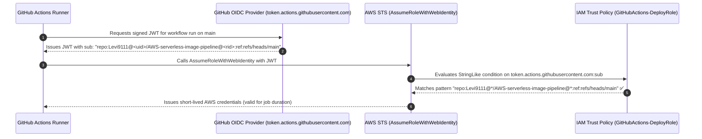
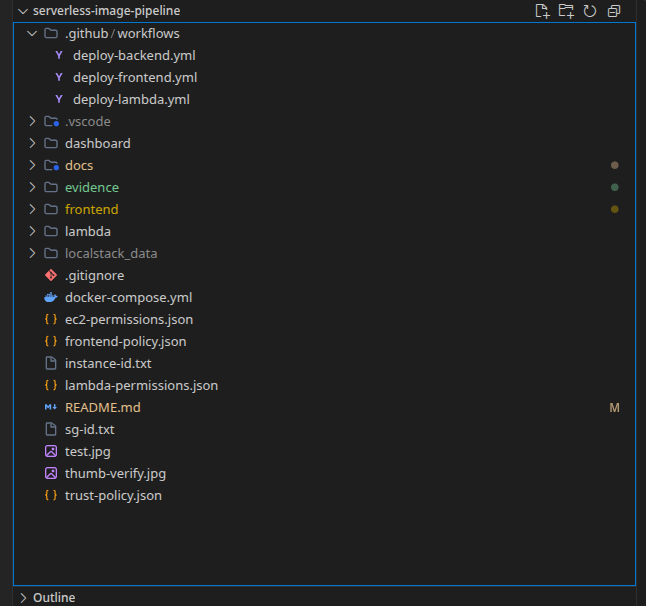
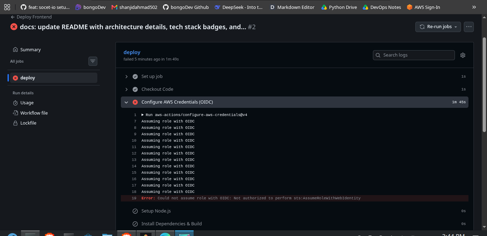
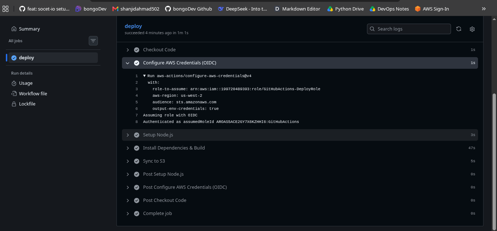
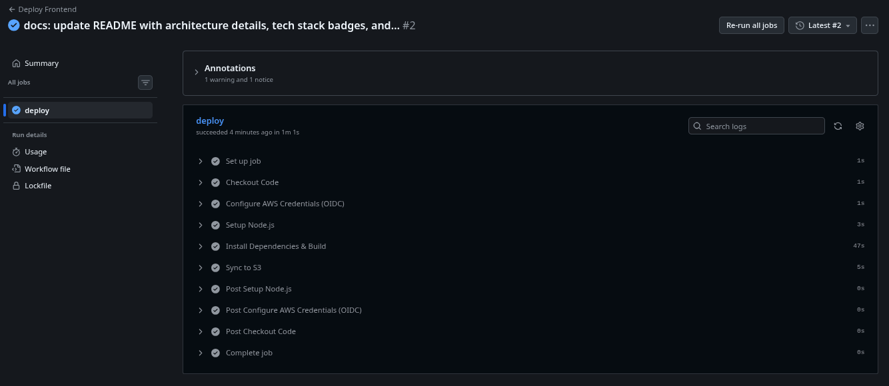
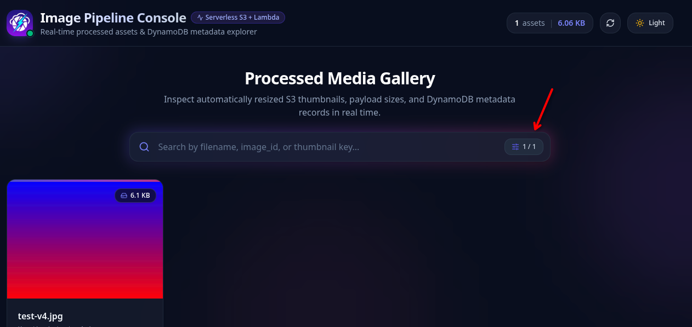
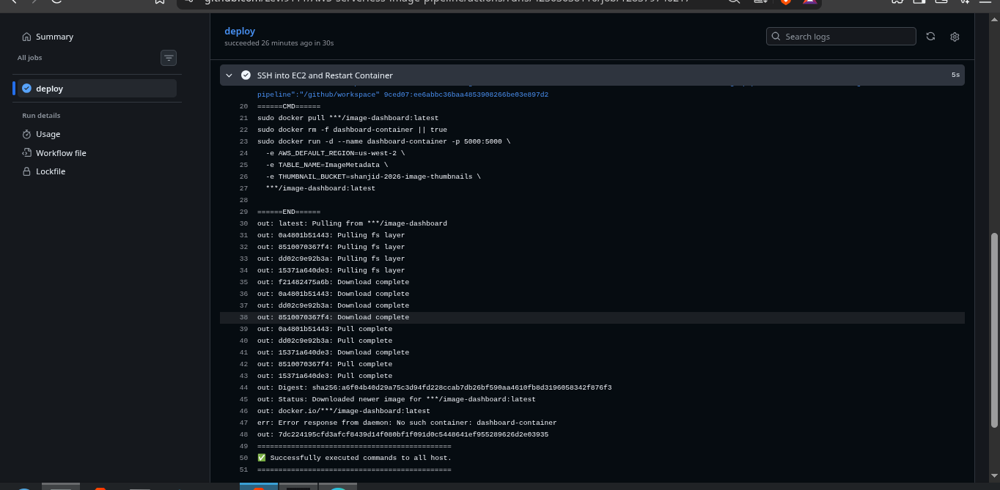
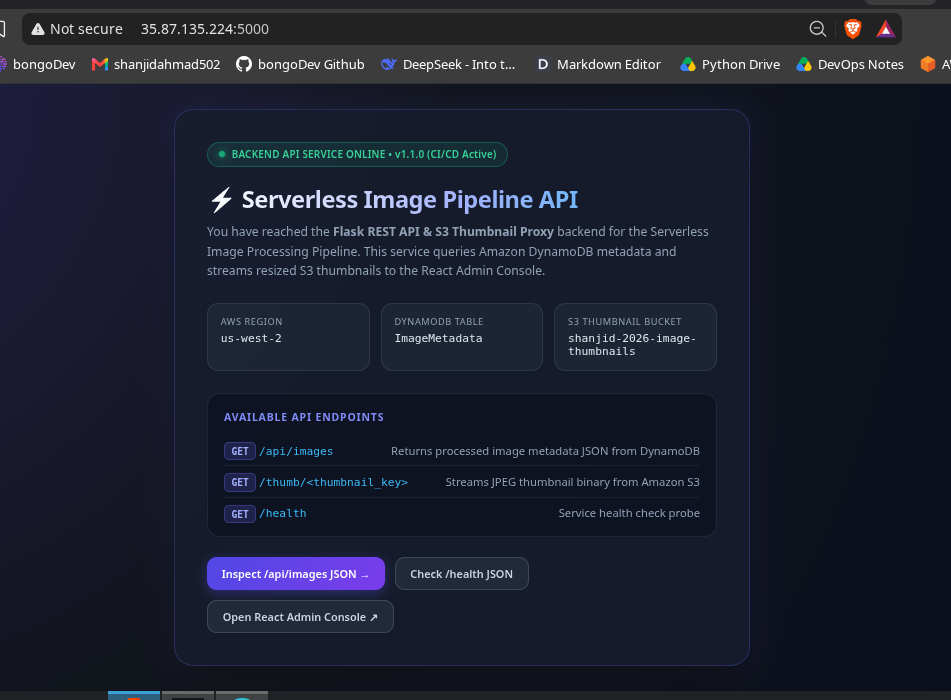
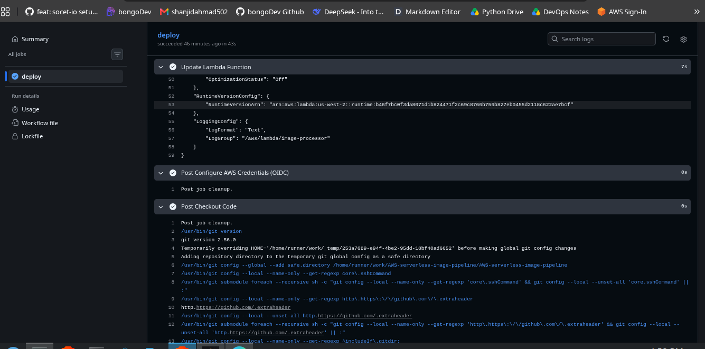

<div align="center">
  <a href="./06-phase-img-process-bug.md">⬅️ Prev: Lambda Image Processing Bug Fixes</a> &nbsp;|&nbsp;
  <a href="../../README.md">🏠 Back to Main README</a> &nbsp;|&nbsp;
  <a href="../architecture.md">🏗️ System Architecture ➡️</a>
</div>

---

# Case Study 08: CI/CD OIDC Authentication, The GitHub Immutable ID Trap & Multi-Tier Automation (Phase 6)

| Field | Details |
| :--- | :--- |
| **Project** | Serverless Image Processing Pipeline |
| **Phase** | Phase 6 — Automated CI/CD with GitHub Actions & AWS OIDC |
| **Workflows** | [`.github/workflows/deploy-frontend.yml`](../../.github/workflows/deploy-frontend.yml), [`deploy-backend.yml`](../../.github/workflows/deploy-backend.yml), [`deploy-lambda.yml`](../../.github/workflows/deploy-lambda.yml) |
| **Authentication** | AWS OpenID Connect (`sts:AssumeRoleWithWebIdentity`), Docker Hub Access Token, EC2 SSH Action |
| **Outcome** | ✅ **Resolved** — Zero-touch deployments live across S3 Frontend, EC2 Docker Backend, and AWS Lambda |

---

## 1. Executive Summary

To complete the engineering lifecycle, we built three path-filtered **GitHub Actions CI/CD pipelines** that automatically build and deploy the **React Frontend (`frontend/**`)**, **Flask Docker Backend (`dashboard/**`)**, and **Python 3.9 Lambda (`lambda/**`)** on every push to `main`.

Following modern cloud security standards, we avoided storing long-lived `AWS_ACCESS_KEY_ID` and `AWS_SECRET_ACCESS_KEY` credentials in GitHub Secrets, opting instead for **OpenID Connect (OIDC)** federation (`aws-actions/configure-aws-credentials@v4`). During rollout, we diagnosed and resolved two critical authentication blockers:
1. **The GitHub OIDC Immutable ID Trap**: `Not authorized to perform sts:AssumeRoleWithWebIdentity` caused by GitHub's recent addition of numeric immutable repository IDs (`@12345678`) in OIDC `sub` claims.
2. **Case-Sensitive Docker Hub Registry Auth**: `malformed HTTP Authorization header` during image push caused by a capitalized `DOCKERHUB_USERNAME` secret (`Levi9111` vs `levi9111`).

---

## 2. Incident Timeline & Resolutions

| # | Incident | Observed Symptom | Root Cause | Engineering Fix |
| :---: | :--- | :--- | :--- | :--- |
| **1** | **AWS IAM OIDC Wizard Validation** | `"GitHub organization is required"` | The AWS IAM Console wizard prompts for an "Organization" name when configuring the GitHub OIDC provider. | Supplied the personal GitHub account handle (`Levi9111`) as the organization identifier. |
| **2** | **Wildcard Warning in IAM Console** | Console flagged `repo:user/repo:*` | Broad trailing wildcards allow any branch or pull request to assume the role. | Scoped the suffix explicitly to the production branch: `:ref:refs/heads/main`. |
| **3** | **OIDC `AssumeRoleWithWebIdentity` Failure** | `Error: Could not assume role with OIDC: Not authorized to perform sts:AssumeRoleWithWebIdentity` | GitHub updated OIDC `sub` claims to embed immutable numeric IDs (`repo:Levi9111@12345/AWS-serverless-image-pipeline@67890:ref:refs/heads/main`), causing an exact string match without `@*` to fail. | Updated the IAM Trust Policy `StringLike` condition to `repo:Levi9111@*/AWS-serverless-image-pipeline@*:ref:refs/heads/main`. |
| **4** | **Docker Hub Registry Auth Error** | `malformed HTTP Authorization header` | The `DOCKERHUB_USERNAME` GitHub Secret had a capital `L` (`Levi9111`), whereas Docker Hub registry namespaces and IDs are strictly lowercase (`levi9111`) + switched to `docker/login-action@v3`. | Updated `DOCKERHUB_USERNAME` secret to lowercase `levi9111` and used `docker/login-action@v3`. |

---

## 3. Deep Dive: The GitHub OIDC "Immutable ID" Claim Format



### Why Traditional OIDC Policies Break
Historically, GitHub's OIDC `sub` (subject) claim followed the format:
```text
repo:Levi9111/AWS-serverless-image-pipeline:ref:refs/heads/main
```
With GitHub's introduction of **Immutable Repository & Owner IDs**, the subject claim embeds numeric identifiers:
```text
repo:Levi9111@12345678/AWS-serverless-image-pipeline@87654321:ref:refs/heads/main
```
Using `StringLike` with targeted `@*` wildcards preserves strict repository and branch isolation (`refs/heads/main`) while accommodating GitHub's immutable numeric suffixes:

```json
{
  "Version": "2012-10-17",
  "Statement": [
    {
      "Effect": "Allow",
      "Principal": {
        "Federated": "arn:aws:iam::199720489393:oidc-provider/token.actions.githubusercontent.com"
      },
      "Action": "sts:AssumeRoleWithWebIdentity",
      "Condition": {
        "StringEquals": {
          "token.actions.githubusercontent.com:aud": "sts.amazonaws.com"
        },
        "StringLike": {
          "token.actions.githubusercontent.com:sub": "repo:Levi9111@*/AWS-serverless-image-pipeline@*:ref:refs/heads/main"
        }
      }
    }
  ]
}
```

---

## 4. Step-by-Step Verification & Visual Evidence

### 4.1 Multi-Tier Workflow Structure (`phase-6-repo-workflows.png`)
All three workflows reside in `.github/workflows/` with path-based triggers (`frontend/**`, `dashboard/**`, `lambda/**`) so commits only build and deploy the modified service tier:



---

### 4.2 OIDC Failure vs. OIDC Resolution (`deploy-frontend.yml`)

| 1. Initial OIDC Failure (`Not authorized to perform sts:AssumeRoleWithWebIdentity`) | 2. OIDC Fixed (`Authenticated as assumedRoleId ...:GitHubActions`) |
| :---: | :---: |
|  |  |

---

### 4.3 Frontend CI/CD Pipeline & Live UI Update Verification
Once OIDC succeeded, GitHub Actions built the TypeScript + Vite bundle in `47s`, synced `frontend/dist/` to `s3://shanjid-2026-frontend/`, and the fixed `1 / 1` search counter badge went live immediately:

| 1. Full `Deploy Frontend` Job Green (`1m 1s`) | 2. Live S3 Frontend Updated via CI/CD (`1 / 1` Badge Fixed) |
| :---: | :---: |
|  |  |

---

### 4.4 Backend CI/CD Pipeline (`deploy-backend.yml`) — Docker Hub + EC2 SSH Rollout
After fixing the lowercase `DOCKERHUB_USERNAME` secret (`levi9111`), pushing the `v1.1.0` welcome UI update in [`dashboard/app.py`](../../dashboard/app.py) triggered `deploy-backend.yml`. The workflow built and pushed `image-dashboard:latest` to Docker Hub, SSHed into EC2 (`35.87.135.224`), pulled the fresh image, and restarted `dashboard-container`:

| 1. GitHub Actions SSH Container Rollout (`phase-6-backend-ssh-success.png`) | 2. Live EC2 Backend Root UI (`v1.1.0 (CI/CD Active)`) (`phase-6-backend-live.png`) |
| :---: | :---: |
|  |  |

---

### 4.5 Serverless Lambda CI/CD Pipeline (`deploy-lambda.yml`)
Pushing changes to `lambda/**` triggered `deploy-lambda.yml`, which compiled `Pillow==10.4.0` inside `public.ecr.aws/sam/build-python3.9:latest`, packaged `function.zip`, authenticated via OIDC, and executed `aws lambda update-function-code` in `43s`:



---

## 5. Key Engineering Lessons

1. **Zero Static AWS Credentials in CI/CD**: By pairing **AWS OIDC** (`GitHubActions-DeployRole`) with **EC2 IAM Instance Profiles**, there is not a single static `AWS_ACCESS_KEY_ID` stored in GitHub Secrets or inside any running container.
2. **Verify OIDC Subject (`sub`) Claims**: Cloud providers and identity providers evolve their token schemas (like GitHub's immutable numeric IDs). Scoping `StringLike` conditions carefully avoids brittle string mismatches without sacrificing least-privilege branch restrictions.
3. **Case Sensitivity Across Registries**: GitHub usernames allow PascalCase (`Levi9111`), whereas Docker Hub namespaces enforce lowercase (`levi9111`). Always match registry-specific normalization rules in CI secrets.
4. **Path-Filtered Monorepo Workflows**: Using `on.push.paths` (`frontend/**`, `dashboard/**`, `lambda/**`) keeps CI/CD feedback loops under 60 seconds and prevents unnecessary rebuilds of unchanged services.

---

<div align="center">
  <a href="./06-phase-img-process-bug.md">⬅️ Prev: Lambda Image Processing Bug Fixes</a> &nbsp;|&nbsp;
  <a href="../../README.md">🏠 Back to Main README</a> &nbsp;|&nbsp;
  <a href="../architecture.md">🏗️ System Architecture ➡️</a>
</div>
