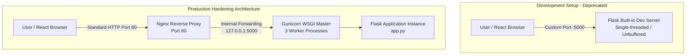

<div align="center">
  <a href="./07-phase-6-cicd-oidc-errors.md">⬅️ Prev: Case Study 08 — CI/CD & OIDC Auth</a> &nbsp;|&nbsp;
  <a href="../../README.md">🏠 Back to Main README</a> &nbsp;|&nbsp;
  <a href="../architecture.md">🏗️ System Architecture ➡️</a>
</div>

---

# Case Study 09: Production Hardening with Nginx & Gunicorn (Phase 6)

| Field | Details |
| :--- | :--- |
| **Project** | Serverless Image Processing Pipeline |
| **Phase** | Phase 6 — CI/CD & Production Hardening |
| **Date** | 2026-11-07 |
| **Components** | Nginx Reverse Proxy (Port 80), Gunicorn WSGI (`3 workers`), Docker, EC2 Security Group, GitHub Actions |
| **Outcome** | ✅ **Resolved** — Backend upgraded from Flask development server to multi-process Nginx + Gunicorn architecture running on standard HTTP Port 80 |

---

## 1. Executive Summary

Initially, the Flask backend was deployed to Amazon EC2 using Flask's built-in development server (`app.run()`). While functional for testing, this approach had severe limitations for a live application: it is single-threaded, lacks security protections, and forces users to access the API via an unconventional custom port (`:5000`).

To achieve a production-grade architecture, we containerized a multi-process setup using **Nginx** as a reverse proxy on Port 80 and **Gunicorn** as the Python WSGI server on internal Port 5000. This required coordinated updates across the multi-process Docker container, the GitHub Actions CI/CD pipeline, the AWS EC2 security group, and the frontend configuration.

---

## 2. Architectural Evolution



### Before (Development)
```text
User Browser (Port 5000) ---> Flask Development Server (Python single process)
```

### After (Production)
```text
User Browser (Port 80)
   ↓
Nginx (Reverse Proxy & HTTP Acceleration)
   ↓ (Internal container loopback)
Gunicorn (WSGI Server - 3 Concurrent Workers)
   ↓
Flask Application (boto3 DynamoDB & S3 Client)
```

---

## 3. The "Port 80 vs Port 5000" Concept

A common point of confusion for developers is why they had to type `:5000` in the URL before, but don't have to type `:80` now:

* **Port 80** is the universal, default port for HTTP traffic. Web browsers automatically append `:80` to every `http://` request behind the scenes. Therefore, it is cleanly omitted in user-facing URLs.
* **Port 5000** is an arbitrary development port. Because it is not the default, browsers require users and API clients to explicitly type it (`http://35.87.135.224:5000`).

By placing Nginx at Port 80, we achieve a clean, professional endpoint (`http://35.87.135.224`), while keeping the Python WSGI server isolated on Port 5000 within the container's internal networking boundary. Port 5000 is never exposed to the public internet.

---

## 4. Implementation Details

### 4.1 Dependency & WSGI Server (`requirements.txt`)
Added `gunicorn==21.2.0` to [`dashboard/requirements.txt`](../../dashboard/requirements.txt). Gunicorn is a production-grade WSGI HTTP server that spawns multiple worker processes (`--workers 3`) to handle concurrent requests simultaneously, eliminating the single-threaded blocking bottleneck of Flask's built-in server.

```text
flask==3.0.0
flask-cors==4.0.0
boto3==1.34.0
gunicorn==21.2.0
```

### 4.2 Reverse Proxy Configuration (`nginx.conf`)
Created [`dashboard/nginx.conf`](../../dashboard/nginx.conf) to bind to Port 80 and forward incoming requests internally to `http://127.0.0.1:5000`. Configured client headers to preserve auditability and real client IPs:

```nginx
server {
    listen 80;
    server_name _;

    location / {
        proxy_pass http://127.0.0.1:5000;
        proxy_set_header Host $host;
        proxy_set_header X-Real-IP $remote_addr;
        proxy_set_header X-Forwarded-For $proxy_add_x_forwarded_for;
    }
}
```

### 4.3 Multi-Process Container Build (`Dockerfile`)
Updated [`dashboard/Dockerfile`](../../dashboard/Dockerfile) to install Nginx via `apt-get`, deploy the configuration, expose Port 80, and coordinate both services:

```dockerfile
FROM python:3.11-slim

# Install Nginx
RUN apt-get update && apt-get install -y nginx && rm -rf /var/lib/apt/lists/*

WORKDIR /app

# Copy requirements and install
COPY requirements.txt .
RUN pip install --no-cache-dir -r requirements.txt

# Copy the app and Nginx config
COPY app.py .
COPY nginx.conf /etc/nginx/sites-available/default

# Expose port 80 (Nginx)
EXPOSE 80

# Start Nginx and Gunicorn
CMD service nginx start && gunicorn --bind 0.0.0.0:5000 --workers 3 app:app
```

### 4.4 Cascading CI/CD & Infrastructure Updates
Because the container now exposes Port 80 instead of 5000:
1. **CI/CD Pipeline** ([`.github/workflows/deploy-backend.yml`](../../.github/workflows/deploy-backend.yml)): Updated container port publishing on EC2:
   ```bash
   sudo docker run -d --name dashboard-container -p 80:80 \
     -e AWS_DEFAULT_REGION=us-west-2 \
     -e TABLE_NAME=ImageMetadata \
     -e THUMBNAIL_BUCKET=shanjid-2026-image-thumbnails \
     ${{ secrets.DOCKERHUB_USERNAME }}/image-dashboard:latest
   ```
2. **AWS Security Group**: Allowed inbound TCP port 80 (`HTTP`) from `0.0.0.0/0` on `sg-00baed54e5d8fe23d`.
3. **Frontend Client**: Updated `VITE_API_BASE_URL` in [frontend/.env](../../frontend/.env) from `http://35.87.135.224:5000` to `http://35.87.135.224`.

---

## 5. Key Lessons Learned

1. **Never use the Flask development server in production**: The console notice (`WARNING: This is a development server. Do not use it in a production deployment.`) is a genuine security and stability warning. Gunicorn must be used for concurrency and worker isolation.
2. **Reverse Proxies are standard practice**: Nginx provides request buffering, DDoS mitigation, clean URL routing, header rewriting, and a ready foundation for TLS/SSL termination.
3. **Docker multi-process orchestration**: While containers typically run one process, chaining services (`service nginx start && gunicorn ...`) or using process managers like `supervisord` is a proven, lightweight pattern for tightly coupled web server / WSGI pairs.
4. **Infrastructure changes cascade**: Migrating an application port cascades across Dockerfiles, CI/CD deployment automation, Cloud Security Groups, and frontend API configuration. Having automated CI/CD ensures that testing and redeploying all affected tiers remains reproducible and rapid.

---

<div align="center">
  <a href="./07-phase-6-cicd-oidc-errors.md">⬅️ Prev: Case Study 08 — CI/CD & OIDC Auth</a> &nbsp;|&nbsp;
  <a href="../../README.md">🏠 Back to Main README</a> &nbsp;|&nbsp;
  <a href="../architecture.md">🏗️ System Architecture ➡️</a>
</div>

